# NR Sidelink Mode 2 in an Open Field

*How the MAC picks resources, what one link delivers, and what many vehicles get, on a 3GPP Rel-16 stack (`nrSidelink`)*

---

## How to read this report

The study is built in three steps, each resting on the one before:

1. **Part A – MAC procedures.** What the specification promises, and how a UE senses, excludes and
   selects resources: semi-persistent scheduling (SPS) for periodic traffic, and one-shot selection
   for event traffic. No radio channel is needed to explain this.
2. **Part B – One link, real PHY.** Range, throughput and latency of a single link for MCS 5, 6, 11
   and 27, against distance and speed. The physical layer is simulated, not abstracted, and the link
   uses the TR 38.901 RMa path loss with antennas at 3 m on agricultural machinery; with these
   values MCS 5 reaches 1500 m, as in the field.
3. **Part C – Many UEs in a field.** A 1 km × 1 km deployment at several densities, with the traffic
   flows stated first, and every flow judged against its own packet error rate.

### The setup, once

| Item | Value |
|---|---|
| Channel | 20 MHz at 5.9 GHz, 30 kHz subcarrier spacing (numerology μ = 1), 0.5 ms slots |
| Resource pool | 5 sub-channels × 10 PRB = 50 PRB |
| Transmit power | 23 dBm |
| Propagation | TR 38.901 RMa, line of sight (an open agricultural field); antennas 3 m above ground at both ends (machinery cab roof) |
| Antennas | 3 dBi per antenna, 6 dB combined (transmitter + receiver) |
| Receiver | noise figure **9 dB**, the vehicle/pedestrian UE value of 3GPP TR 37.885 V15.3.0, Table 6.1.1-1 |
| Fading | TDL-D (line of sight with multipath), 100 ns delay spread, at 0 / 10 / 20 / 30 mph |
| Selection window | T1 = 5 slots (2.5 ms), the largest TS 38.214 allows at μ = 1; T2 = PDB − 3 slots |
| Latency pipeline | the transport block is built during T1; then 1 transmission slot and 2 slots to receive it |
| Traffic classes | the five broadcast PQIs of TS 23.287 Table 5.4.4-1: 55, 56, 57, 58, 59 |

**What a latency is here.** A packet arrives in slot n and is transmitted in slot n + k. The
transport block is generated during T1: that preparation is what T<sub>proc,1</sub> is for. The
packet is delivered at slot n + k + 3:
- **1 slot** is the transmission slot itself, while the TB is on the air;
- **2 slots** are for the receiver to demodulate, decode and pass it up.

**Every latency in this report includes those three slots.** With k drawn uniformly in [T1, T2]:

&nbsp;&nbsp;&nbsp;&nbsp;latency = k + 3 slots,&nbsp;&nbsp;mean = (T1 + T2) / 2 + 3 slots,&nbsp;&nbsp;T2 = PDB − 3 slots

**T1 and T2.** The UE may place its transmission anywhere in [n + T1, n + T2].
- T1 must be at least the processing time T<sub>proc,1</sub> (TS 38.214 Table 8.1.4-2: 5 slots at
  μ = 1), and we take exactly that.
- T2 may not exceed the remaining delay budget. Because the transmission slot and the two reception
  slots must all fit inside the PDB, the last allowed slot is **T2 = PDB − 3 slots**, so the transmission ends two slots before the deadline
  and the receiver finishes exactly at it. For PDB 10 ms (20 slots), T2 = 17 slots.
- No transport block may carry a packet younger than T<sub>proc,1</sub>, on any grant. Without this
  rule, a packet arriving while the UE already holds an SPS grant could go out in its own arrival
  slot.

So **no packet can be delivered sooner than T1 + 3 slots = 4 ms, nor later than its PDB.**

**Which PQIs.** TS 23.287 Table 5.4.4-1 (V19.0.0) defines ten PQIs. Its NOTE 1 says *"GBR and Delay
Critical GBR PQIs can only be used for unicast PC5 communications"*, which leaves broadcast with the
five Non-GBR rows:

| PQI | Priority | PDB | PER | Target (within PDB) | Example service (Table 5.4.4-1) |
|---|---|---|---|---|---|
| 55 | 3 | 10 ms | 10<sup>−4</sup> | 99.99 % | cooperative lane change, higher degree of automation |
| 56 | 6 | 20 ms | 10<sup>−1</sup> | 90 % | platooning informative exchange; information sharing with an RSU |
| 57 | 5 | 25 ms | 10<sup>−1</sup> | 90 % | cooperative lane change, lower degree of automation |
| 58 | 4 | 100 ms | 10<sup>−2</sup> | 99 % | sensor information sharing, lower degree of automation |
| 59 | 6 | 500 ms | 10<sup>−1</sup> | 90 % | platooning, reporting to an RSU |

A flow **passes** when at least 1 − PER of its packets arrive within the PDB at each intended receiver.

---

# Part A — How Mode 2 picks resources

## A.1 What the specification promises

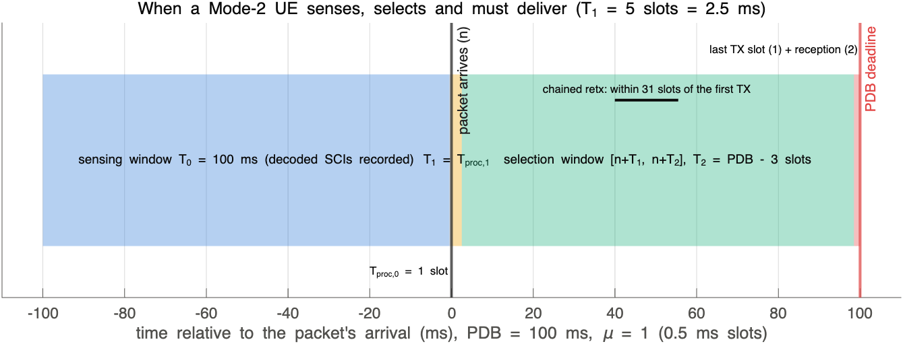

**Figure A.1: When a UE senses, selects and must deliver.** *How to read it:*
- Time runs left to right around the packet's arrival at n.
- For the past 100 ms (the sensing window, `sl-SensingWindow`) the UE has been decoding its
  neighbours' control messages.
- It needs T<sub>proc,1</sub> = 2.5 ms to prepare, then may transmit anywhere in the selection window.
- The last three slots before the PDB are the last transmission slot and the two slots the receiver
  needs.
- A blind retransmission must follow within 31 slots of the first transmission, because that is all
  the SCI's TRIV field can announce (TS 38.214 §8.1.5).

So the delivered latency is bounded on both sides:

- **minimum = T1 + 3 slots = 4 ms**, whatever the PDB;
- **maximum = T2 + 3 slots = the PDB itself**;
- **mean = (T1 + T2) / 2 + 3 slots** when the UE draws uniformly in the window, as Mode 2 does.
  For PQI 55: (5 + 17) / 2 + 3 = 14 slots = 7 ms.

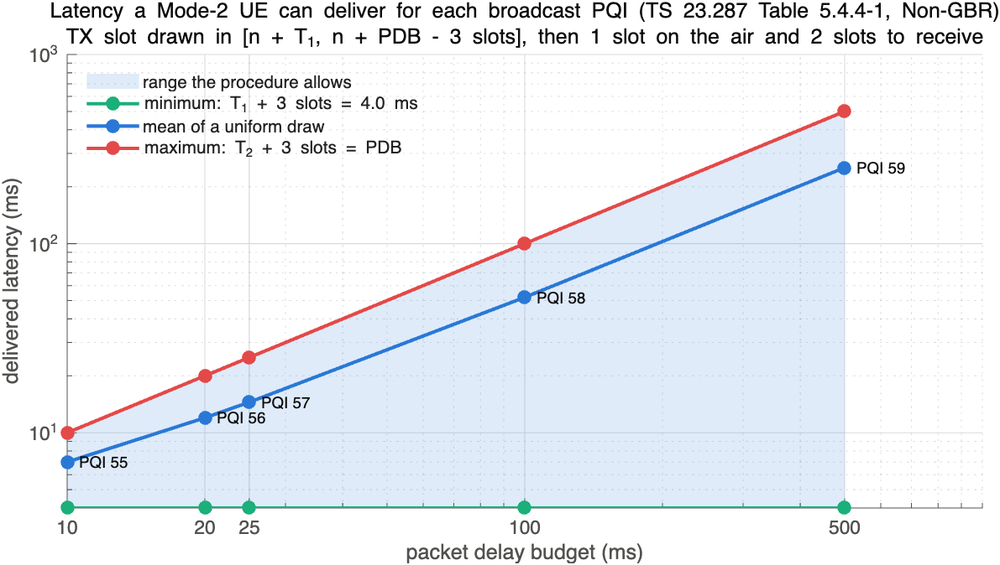

**Figure A.2: The latency each broadcast PQI allows.** The band is everything the procedure permits;
the middle line is where a uniform draw lands on average.

| PQI | PDB | T2 | Minimum | Mean (uniform draw) | Maximum |
|---|---|---|---|---|---|
| 55 | 10 ms | 17 slots | 4 ms | 7 ms | 10 ms |
| 56 | 20 ms | 37 slots | 4 ms | 12 ms | 20 ms |
| 57 | 25 ms | 47 slots | 4 ms | 14.5 ms | 25 ms |
| 58 | 100 ms | 197 slots | 4 ms | 52 ms | 100 ms |
| 59 | 500 ms | 997 slots | 4 ms | 252 ms | 500 ms |

**The key point for everything that follows:** in Mode 2, latency is set by *where in the window the
UE draws its resource*, not by the radio. A PQI 58 message waits about 52 ms on average even on an
empty channel. Delivering earlier means a shorter window, and a shorter window means fewer candidates
to choose from.

## A.2 Sensing: what a UE hears

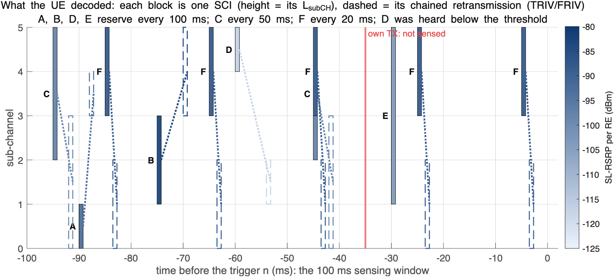

**Figure A.3: One UE's sensing window.** *How to read it:* each solid block is one control message
(SCI-1A) the UE decoded. Its horizontal position is the slot it was heard in, its vertical span the
sub-channels it occupied (its L<sub>subCH</sub>: from 1 to 4 here), and its shade the received power
per resource element (SL-RSRP). The dashed box joined to it is the chained retransmission the same SCI
announced (TRIV gives the slot offset, FRIV the sub-channel). The red line is a slot the UE was itself
transmitting in, so it heard nothing there (half duplex).

Six neighbours, chosen to show every case:

| Neighbour | Width L<sub>subCH</sub> | Reserves every | RSRP | Note |
|---|---|---|---|---|
| A | 1 | 100 ms | −95 dBm | |
| B | 2 | 100 ms | −85 dBm | |
| C | 3 | 50 ms | −100 dBm | heard twice in the window |
| D | 1 | 100 ms | −118 dBm | **below** the −110 dBm threshold |
| E | 4 | 100 ms | −105 dBm | no chained retransmission |
| F | 2 | 20 ms | −90 dBm | heard five times |

Every SCI carries the sender's **reservation period**, so a receiver knows not only where the sender
was but where it will be next.

## A.3 From sensing to a candidate set

When a packet arrives, the UE lists every possible resource in its selection window: each slot × each
starting sub-channel that fits its own width (here L<sub>subCH</sub> = 2). That is the candidate set,
M<sub>total</sub> = 772 resources for a 100 ms window. It then removes every candidate that would
overlap a neighbour's **projected** reservation heard above the RSRP threshold (TS 38.214 §8.1.4).

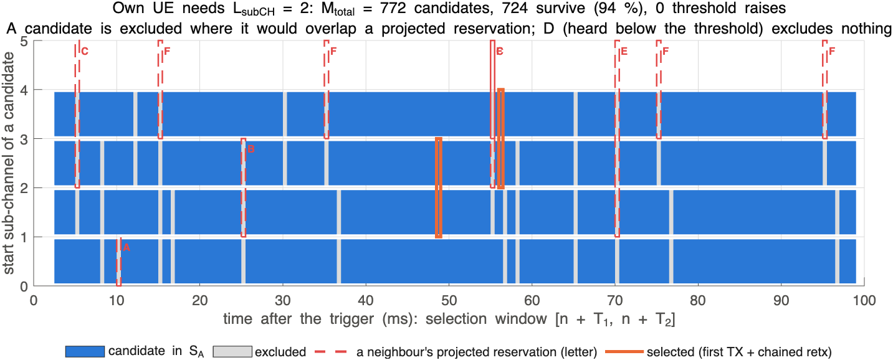

**Figure A.4: Exclusion in the selection window.** *How to read it:* blue cells survive, grey cells are
excluded, dashed red outlines are the neighbours' projected reservations (letters as in Figure A.3).
F, which reserves every 20 ms, blocks a column every 20 ms; D, heard below the threshold, blocks
nothing. The unlabelled grey slivers are projected chained retransmissions and the slots the UE could
not sense (the spec assumes the worst for those). The UE then draws its resource at random from the
survivors (orange): here 724 of 772 survive (94 %).

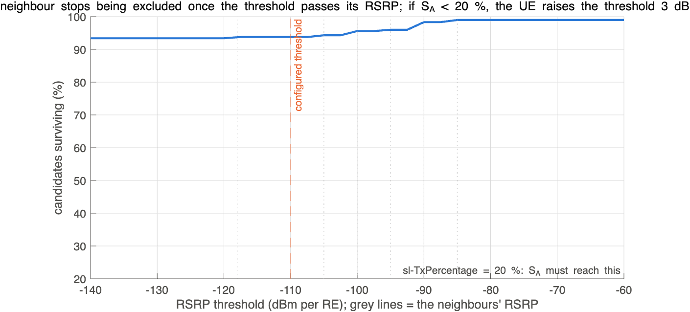

**Figure A.5: The threshold and the escalation rule.** If fewer than `sl-TxPercentage` = 20 % of
candidates survive, the UE raises the RSRP threshold by 3 dB and tries again. Each neighbour stops
being excluded once the threshold passes its RSRP (grey lines). In a crowded channel this is how a UE
still finds a resource: by accepting overlap with distant, weak neighbours.

## A.4 Periodic traffic: sensing-based semi-persistent scheduling (SPS)

For a periodic message such as a CAM, the UE keeps the selected resource and reuses it every
reservation period, announcing each next use in its SCI.

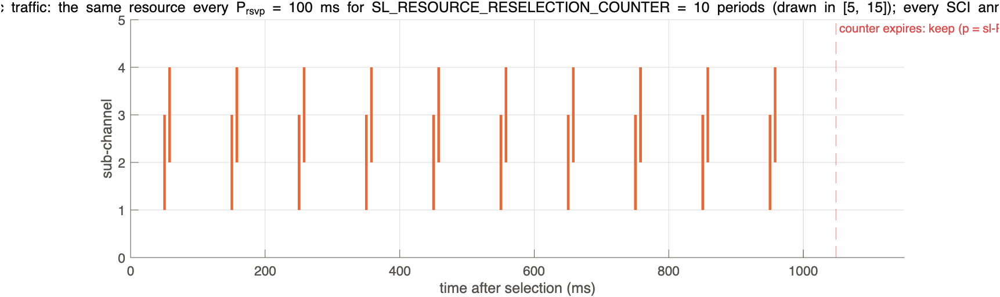

**Figure A.6: One SPS reservation.** The resource (and its chained retransmission) repeats every
P<sub>rsvp</sub> = 100 ms for a random number of periods (TS 38.321 §5.22.1.1: 5–15 periods at
100 ms). When the counter expires, the UE keeps the resource with probability `sl-ProbResourceKeep`
(0.4 here) or selects a new one.

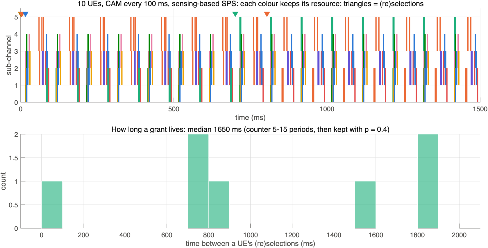

**Figure A.7: SPS in a running simulation**, 10 UEs sending a PQI 58 message every 100 ms. *How to read it:* each
colour is one UE; the same colour returning to the same sub-channels every 100 ms is SPS at work, and
triangles mark (re)selections. A grant lives about 1.65 s (median), so neighbours have more than a
second to learn and avoid it. That is why sensing works well for periodic traffic: none of the
transmissions in this run collided.

## A.5 Event traffic: one-shot selection

An event message (a cooperative lane change, PQI 55 or 57) arrives at a random time and needs no
reservation for later. The UE performs a one-shot selection with no reservation period
(P<sub>rsvp</sub> = 0) in the same window [n + T1, n + PDB − 3 slots], using the same sensing
history.

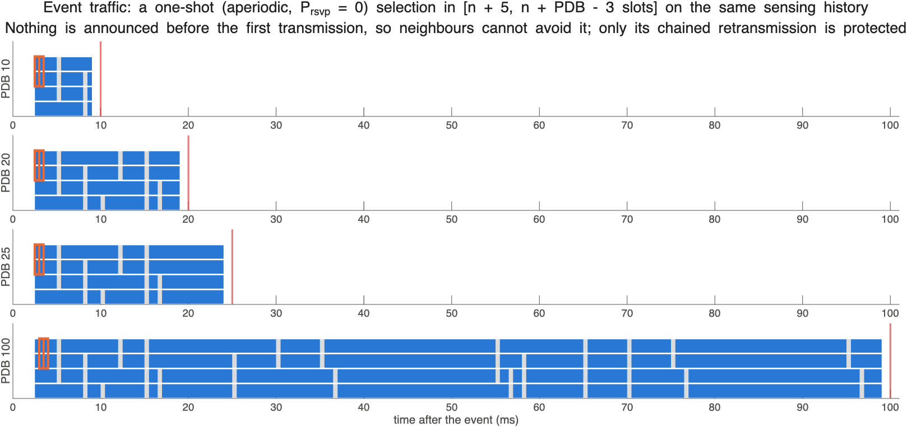

**Figure A.8: Event selection for the PDBs of PQI 55, 56, 57 and 58 (10, 20, 25, 100 ms).** The window
shrinks with the PDB: for PDB 10 ms only 52 candidates exist (46 survive), against 772 for 100 ms.

| PDB | Transmission window | Candidates (M<sub>total</sub>) | Surviving | Latency min / mean / max |
|---|---|---|---|---|
| 10 ms (PQI 55) | 2.5 – 8.5 ms | 52 | 46 | 4 / 7 / 10 ms |
| 20 ms (PQI 56) | 2.5 – 18.5 ms | 132 | 117 | 4 / 12 / 20 ms |
| 25 ms (PQI 57) | 2.5 – 23.5 ms | 172 | 157 | 4 / 14.5 / 25 ms |
| 100 ms (PQI 58) | 2.5 – 98.5 ms | 772 | 724 | 4 / 52 / 100 ms |

**The cost of a one-shot selection:** nothing announces the first transmission before it happens, so
neighbours cannot avoid it. Only its chained retransmission is protected (the first SCI announces it).
Two event messages from nearby UEs can therefore land on the same resource, which SPS largely avoids.

## A.6 Every packet within its PDB, on an empty channel

The bounds above are what the procedure allows. This section checks that the implementation keeps
them, packet by packet. One UE sends 1000 packets of each broadcast PQI to one receiver 100 m away,
with nothing else on the channel. The full system-level MAC runs: sensing, SPS, reselection when a
grant cannot meet the PDB, and one blind retransmission. Each PQI keeps the traffic shape of its
service:
- the lane-change PQIs (55, 57) are events, arriving as a Poisson process with a 100 ms mean;
- PQIs 56 and 58 are periodic every 100 ms; PQI 59 is periodic every 500 ms.

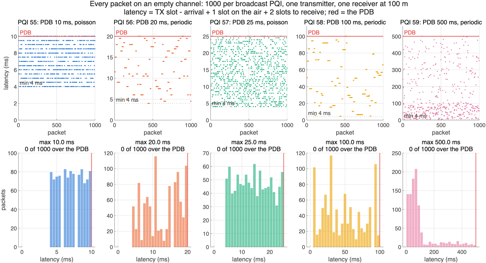

**Figure A.9: The latency of every packet.** *How to read it:*
- Top row: one dot per packet, in order of arrival. The red line is the PDB; the dotted line is the
  4 ms floor.
- Bottom row: the same latencies as a histogram.

| PQI | PDB | Traffic | Packets | Min | Mean | Max | **Over the PDB** |
|---|---|---|---|---|---|---|---|
| 55 | 10 ms | events, mean 100 ms | 1000 | 4.0 ms | 7.0 ms | 10.0 ms | **0** |
| 56 | 20 ms | every 100 ms | 1000 | 4.0 ms | 12.6 ms | 20.0 ms | **0** |
| 57 | 25 ms | events, mean 100 ms | 1000 | 4.0 ms | 14.0 ms | 25.0 ms | **0** |
| 58 | 100 ms | every 100 ms | 1000 | 4.5 ms | 47.0 ms | 100.0 ms | **0** |
| 59 | 500 ms | every 500 ms | 1000 | 4.5 ms | 97.8 ms | 500.0 ms | **0** |

**No packet of any PQI misses its PDB, and none arrives sooner than 4 ms.** The maximum equals the PDB
exactly, as the window allows. Three patterns are worth reading in the figure:

- **Events (55, 57) spread uniformly** between 4 ms and the PDB: every event makes a fresh draw.
- **Periodic traffic (56, 58) forms horizontal runs.** A selected resource is reused every period, so
  consecutive packets see the same latency until the grant is reselected.
- **PQI 59** is mostly delivered within ~100 ms, well inside its budget. It is periodic at 500 ms but
  reserves every 100 ms, so it usually finds a reserved slot soon after arriving.

> **Two simulator faults were found and fixed by this check.**
> 1. A packet arriving onto an existing SPS grant could be sent in its own arrival slot, giving
>    1.5 ms latencies below the 4 ms floor. Packets younger than T<sub>proc,1</sub> are now held
>    back.
> 2. When two lane-change events arrived 2–4 slots apart, the grant chosen for the first had no room
>    for the second. After the first went out, too little budget was left to reselect, so the second
>    expired unsent: 3 of 1000 PQI 55 packets. The MAC now reselects as soon as the pending data no
>    longer fits.

## A.7 Part A in one paragraph

Mode 2 lets a UE deliver a packet no sooner than 4 ms after it arrives (T1 = 2.5 ms of preparation,
then 1 slot on the air and 2 slots to receive) and no later than its PDB. A uniform draw lands in the
middle on average. On an empty channel the implementation keeps both bounds for every one of 5000
packets across the five broadcast PQIs. Sensing protects a transmission only when it was announced in
advance: always for SPS (every period announces the next), never for the first transmission of an
event. Everything in Parts B and C is this procedure running over a real radio link.

---

# Part B — One link, real PHY

Every number here comes from the **link-level simulator**: the normative PSCCH/PSSCH transmit chains,
a real OFDM waveform, a TDL-D fading channel with an independent realisation for every transport
block, channel estimation from the DM-RS, equalisation, LDPC decoding with HARQ soft combining, and the
CRC check. Nothing is approximated by a formula. The only inputs are distance (through the link
budget) and speed (through the fading).

## B.1 The link budget

Received SNR per resource element over 50 PRB:

&nbsp;&nbsp;&nbsp;&nbsp;SNR(d) = 23 dBm + G − PL<sub>RMa</sub>(d) − 10·log10(12 × 50) − N<sub>RE</sub>,
&nbsp;&nbsp;N<sub>RE</sub> = −174 dBm/Hz + 10·log10(30 kHz) + 9 dB = −120.2 dBm

| Term | Value | Source |
|---|---|---|
| Transmit power | 23 dBm | P<sub>CMAX</sub> of the operating point |
| Path loss PL<sub>RMa</sub> | TR 38.901 Rural Macro, line of sight, 5.9 GHz | 3GPP TR 38.901 Table 7.4.1-1 |
| Antenna height | 3 m at both ends | deployment: antenna on the cab roof of agricultural machinery |
| Antenna gain G | 3 dBi + 3 dBi = 6 dB | deployment assumption |
| Noise figure | 9 dB | 3GPP TR 37.885 V15.3.0, Table 6.1.1-1 (vehicle and pedestrian UE) |

**Why the height matters.** RMa has a breakpoint at d<sub>BP</sub> = 2π·h<sub>TX</sub>·h<sub>RX</sub>·f<sub>c</sub>/c.
Beyond it the loss grows at 40 dB per decade instead of 20.
- At the 1.5 m of a passenger car (TR 37.885's default), d<sub>BP</sub> = 278 m, and the loss at 1500 m
  is 15.5 dB worse than free space. MCS 5 would reach only about 830 m.
- At 3 m, d<sub>BP</sub> = 1112 m. **With these values MCS 5 has 5.14 dB of SNR at 1500 m against the
  4.93 dB it needs**, so it reaches 1500 m, as in the field.

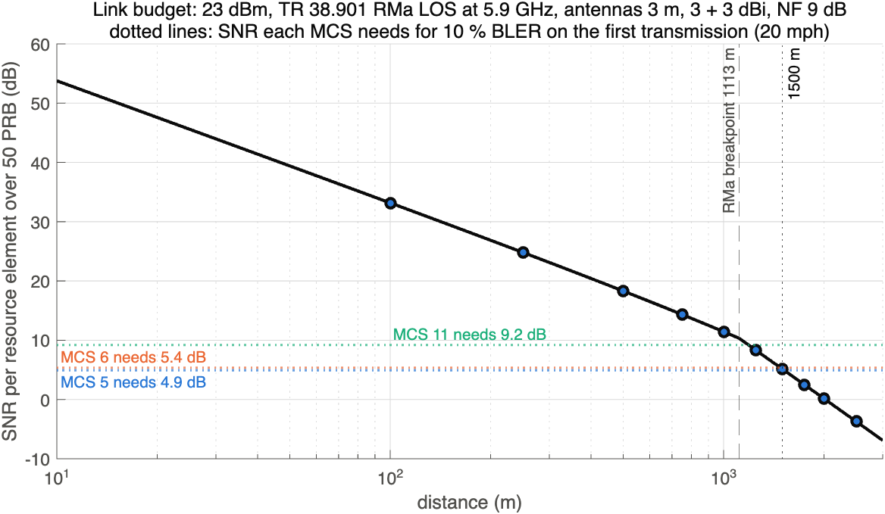

**Figure B.1: SNR against distance**, with the SNR each MCS needs (10 % block error, first
transmission, 20 mph) and the RMa breakpoint marked.

| Distance | 100 m | 250 m | 500 m | 750 m | 1000 m | 1250 m | 1500 m | 1750 m | 2000 m | 2500 m |
|---|---|---|---|---|---|---|---|---|---|---|
| Path loss (RMa) | 88.3 dB | 96.6 dB | 103.1 dB | 107.1 dB | 110.0 dB | 113.1 dB | 116.3 dB | 119.0 dB | 121.3 dB | 125.2 dB |
| SNR per RE | 33.2 dB | 24.8 dB | 18.3 dB | 14.3 dB | 11.4 dB | 8.3 dB | 5.1 dB | 2.5 dB | 0.1 dB | −3.7 dB |
| Received power (50 PRB) | −59.3 dBm | −67.6 dBm | −74.1 dBm | −78.1 dBm | −81.0 dBm | −84.1 dBm | −87.3 dBm | −90.0 dBm | −92.3 dBm | −96.2 dBm |

## B.2 How speed changes the PHY

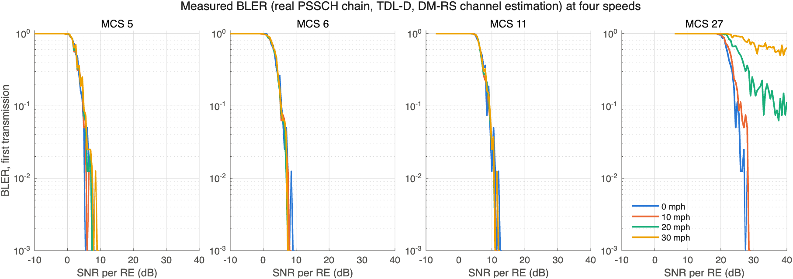

**Figure B.2: Measured block error rate at 0, 10, 20 and 30 mph.** Speed here is the relative speed of
the two vehicles, which sets the Doppler spread. For MCS 5, 6 and 11 the curves barely move: QPSK and
16QAM at moderate code rates are robust to these Doppler levels, and the line-of-sight path of TDL-D
dominates. MCS 27 (64QAM, code rate 0.89) is different. It needs high SNR at every speed, and from
20 mph its first-transmission error rate never falls below 10 % at any SNR: the channel changes between
the two DM-RS symbols faster than linear interpolation can follow.

## B.3 Range

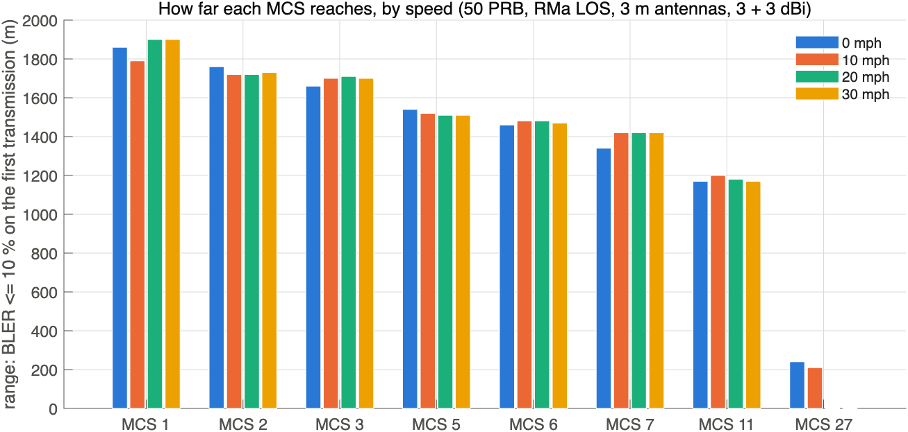

**Figure B.3: How far each MCS reaches** (first transmission decoded with at least 90 % probability).

| MCS | Modulation, code rate | 0 mph | 10 mph | 20 mph | 30 mph | After 3 transmissions (20 mph) |
|---|---|---|---|---|---|---|
| 1 | QPSK 0.15 | 1860 m | 1790 m | 1900 m | 1900 m | 2260 m |
| 2 | QPSK 0.19 | 1760 m | 1720 m | 1720 m | 1730 m | 2160 m |
| 3 | QPSK 0.25 | 1660 m | 1700 m | 1710 m | 1700 m | 2100 m |
| **5** | QPSK 0.37 | **1540 m** | **1520 m** | **1510 m** | **1510 m** | 1930 m |
| **6** | QPSK 0.44 | **1460 m** | **1480 m** | **1480 m** | **1470 m** | 1900 m |
| 7 | QPSK 0.51 | 1340 m | 1420 m | 1420 m | 1420 m | 1840 m |
| **11** | 16QAM 0.37 | **1170 m** | **1200 m** | **1180 m** | **1170 m** | 1620 m |
| **27** | 64QAM 0.89 | **240 m** | **210 m** | **—** | **—** | 910 m |

- **MCS 5 survives at 1500 m** at every speed on its first transmission.
- **The lower MCS reach further**, but by less than in free space: MCS 1–3 reach 1.7–1.9 km on one
  transmission and 2.1–2.3 km with retransmissions. Beyond the RMa breakpoint every extra dB of
  margin buys less distance, because the loss grows at 40 dB per decade.
- **MCS 27 works only at short range**, and from 20 mph only with retransmissions.

## B.4 Throughput against distance

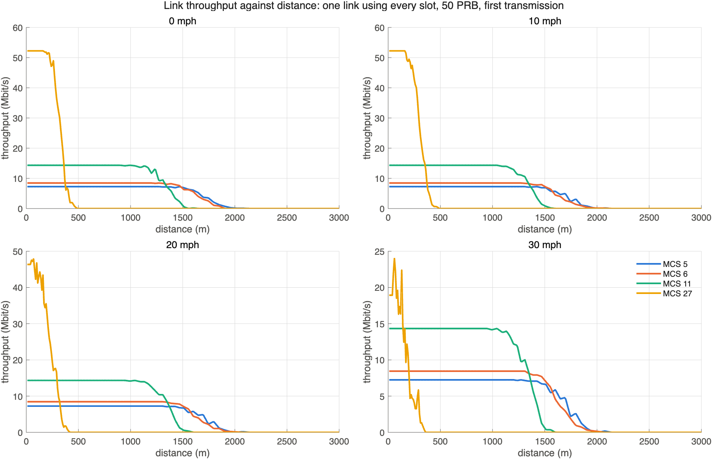

**Figure B.4: Link throughput against distance at each speed.** *How to read it:* the rate one link
achieves if it transmits in every slot over the whole 50-PRB channel, first transmission only:
transport-block size × (1 − block error rate) / 0.5 ms. Each curve is flat at its peak while the link
is clean, then falls over a few hundred metres as the SNR runs out.

| MCS | Peak (error-free) | Held (within 5 % of peak) to | Falls to zero by |
|---|---|---|---|
| 5 | 7.2 Mbit/s | ~1450 m | ~2100 m |
| 6 | 8.4 Mbit/s | ~1380 m | ~2000 m |
| 11 | 14.3 Mbit/s | ~1150 m | ~1580 m |
| 27 | 52.2 Mbit/s (0–10 mph); ~48 Mbit/s at 20 mph; ~24 Mbit/s at 30 mph | 60–220 m | ~400 m |

**Choosing an MCS** is therefore a choice of distance:
- MCS 27 for 25–50 Mbit/s inside ~200 m;
- MCS 11 for 14 Mbit/s to ~1.15 km;
- MCS 5–6 for 7–8 Mbit/s to ~1.4–1.5 km.

These are rates for **one link holding the whole channel in every slot**. What a UE gets when many
share it under sensing is in Part C.4.

## B.5 Latency and reliability against distance, for each PQI's PDB

At link level there are no other users, so latency is the Mode-2 window plus whatever retransmission
the radio needs, plus the 3-slot pipeline.
- The first transmission is drawn uniformly in [n + 5 slots, n + PDB − 3 slots].
- One blind retransmission follows within 31 slots (and before T2), and is soft-combined with the
  first.
- The rows are the PDBs of the broadcast PQIs 55, 56, 57 and 58 (10, 20, 25 and 100 ms).

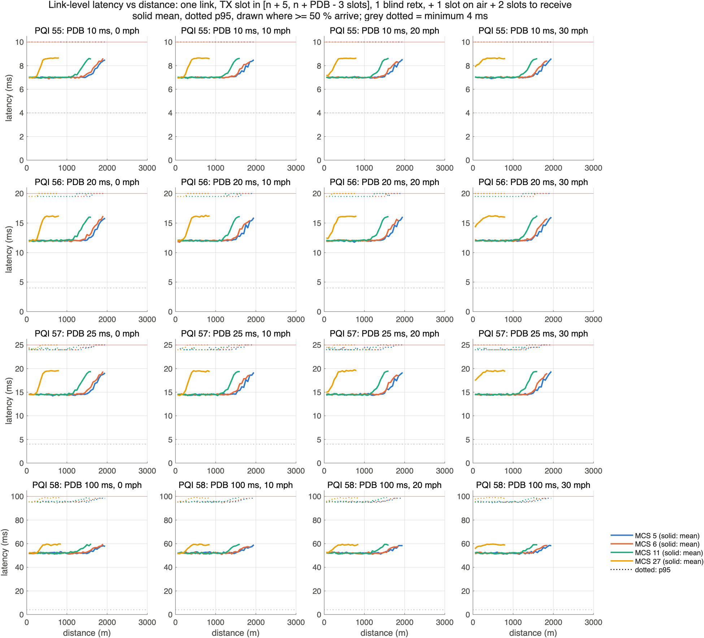

**Figure B.5: Latency against distance**, one row per PQI, one column per speed. *How to read it:*
the solid line is the mean, the dotted line the 95th percentile, drawn where at least half the
packets arrive. The red line is the PDB and the grey dotted line the 4 ms floor.

| PQI (PDB) | Mean inside the range | 95th percentile | Mean near the range edge |
|---|---|---|---|
| 55 (10 ms) | 7.0 ms | 10 ms | ~8.5 ms |
| 56 (20 ms) | 12.0 ms | 19.5 ms | ~16 ms |
| 57 (25 ms) | 14.5 ms | 24–24.5 ms | ~19.5 ms |
| 58 (100 ms) | 52 ms | 95–96 ms | ~59 ms |

- **Inside the range the mean is the middle of the window plus 1.5 ms**, for every MCS and every
  speed. This is exactly the Part A prediction.
- **Towards the range edge the mean rises**, because more packets need the retransmission, which
  comes later.
- **MCS 27's mean is higher everywhere it works**, because at 64QAM it usually needs its
  retransmission.

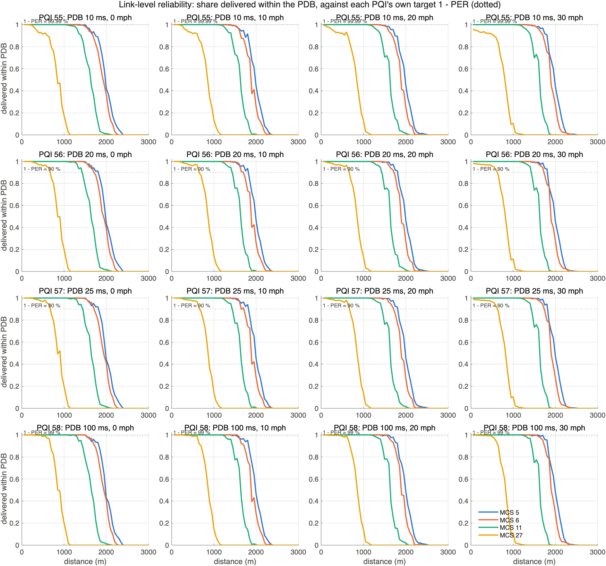

**Figure B.6: Share of packets delivered within the PDB, against distance**, with each PQI's own
target 1 − PER dotted.

Distance up to which each MCS meets the PQI's target at 20 mph:

| MCS | PQI 55 (99.99 %, 10 ms) | PQI 56 (90 %, 20 ms) | PQI 57 (90 %, 25 ms) | PQI 58 (99 %, 100 ms) |
|---|---|---|---|---|
| 5 | 1300 m* | 1800 m | 1800 m | 1600 m |
| 6 | 1300 m* | 1700 m | 1700 m | 1550 m |
| 11 | 950 m* | 1400 m | 1400 m | 1250 m |
| 27 | — | 650 m | 650 m | 450 m |

\* *4000 packets are simulated per point, so 99.99 % here means "no failure seen in 4000", not a
demonstrated 10<sup>−4</sup>.*

With one blind retransmission, every MCS reaches further at the 90 % and 99 % targets than its
single-transmission range in B.3.

## B.6 Speed at a glance

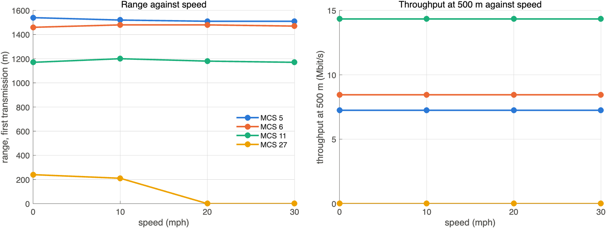

**Figure B.7: Range and throughput at 500 m against speed.** Between 0 and 30 mph speed changes the
range of MCS 5, 6 and 11 by under 5 %. Only MCS 27 is sensitive: its single-transmission throughput at
short range halves by 30 mph.

## B.7 Part B in one paragraph

With RMa line-of-sight propagation, antennas at 3 m on the machinery, 3 dBi each and a 9 dB noise figure
(TR 37.885), MCS 5 reaches 1500 m on its first transmission, and MCS 1–3 reach 1.7–1.9 km.

- **Throughput:** the link carries 7–8 Mbit/s to about 1.4–1.5 km (MCS 5–6), 14 Mbit/s to about 1.15 km
  (MCS 11), and 25–50 Mbit/s only inside ~200 m (MCS 27).
- **Speed:** up to 30 mph it barely matters, except for MCS 27.
- **Reliability with one blind retransmission:** the 90 % PQIs (56, 57) are met to 1.8 km at MCS 5,
  the 99 % PQI 58 to 1.6 km, and PQI 55's 99.99 % to about 1.3 km.
- **Latency** is the middle of the Mode-2 window plus 1.5 ms wherever the link is good.

---

# Part C — Many UEs in a 1 km × 1 km field

Parts A and B looked at one UE choosing resources and one link carrying them. Part C puts many UEs in
one field, all sensing, reserving and transmitting at once. Now the losses come from each other, not
from distance.

## C.1 The traffic, stated before deployment

Every UE runs all five broadcast PQIs at once, each as the service Table 5.4.4-1 names for it. **Each
flow passes when at least 1 − PER of its packets arrive within its PDB, at every intended
receiver.** The target is set by the PQI, not by a generic 90 %.

| Flow | PQI | Arrival | Size | Offered per UE | PDB | PER | **Target (within PDB)** | Priority |
|---|---|---|---|---|---|---|---|---|
| Sensor information sharing | 58 | periodic, every 100 ms | 300 B | 24 kbit/s | 100 ms | 10<sup>−2</sup> | **99 %** | 4 |
| Platooning informative exchange | 56 | periodic, every 100 ms | 200 B | 16 kbit/s | 20 ms | 10<sup>−1</sup> | **90 %** | 6 |
| Platooning, reporting to an RSU | 59 | periodic, every 500 ms | 200 B | 3.2 kbit/s | 500 ms | 10<sup>−1</sup> | **90 %** | 6 |
| Cooperative lane change | 55 | events, Poisson, mean 500 ms | 200 B | 3.2 kbit/s | 10 ms | 10<sup>−4</sup> | **99.99 %** | 3 |
| Cooperative lane change, lower automation | 57 | events, Poisson, mean 1 s | 200 B | 1.6 kbit/s | 25 ms | 10<sup>−1</sup> | **90 %** | 5 |

Total offered load: **48 kbit/s per UE**.

| Setting | Value |
|---|---|
| Field | 1 km × 1 km |
| Densities | **5, 10, 15, 20, 30, 40, 50, 75 and 100 UE/km²** |
| Drops | 3 independent drops per density (seeds 7, 11, 23) |
| Cast type | broadcast; **intended receivers are all UEs within 500 m** of the sender |
| MCS | 11 (16QAM). Part B gives it ~1180 m of range, so every intended receiver is within reach of the radio |
| Resource selection | sensing-based SPS (Part A), P<sub>rsvp</sub> = 100 ms, one blind retransmission, T1 = 5 slots, T2 = PDB − 3 slots |
| Latency | transmission slot − arrival + 3 slots (Part A) |
| Radio | the Part B link (RMa LOS, 3 m antennas, 3 + 3 dBi, NF 9 dB) and the TDL-D block-error tables measured at 20 mph; interference from every overlapping transmission is added to the noise |
| Length | 5 s (10 000 slots) per run |

**How the UEs are distributed.** UE positions are a **homogeneous Poisson point process (PPP)**:
- the number of UEs in the 1 km² field is N ~ Poisson(λ), with λ the density per km²;
- given N, each UE is placed independently and uniformly over the field;
- each seed is a new, independent drop.

| Density (UE/km²) | 5 | 10 | 15 | 20 | 30 | 40 | 50 | 75 | 100 |
|---|---|---|---|---|---|---|---|---|---|
| N in the three drops | 5, 6, 8 | 10, 11, 14 | 15, 16, 20 | 20, 22, 26 | 30, 32, 38 | 41, 42, 49 | 51, 53, 60 | 76, 78, 87 | 101, 104, 114 |
| Mean neighbours within 500 m | 2.2 | 4.9 | 7.6 | 9.3 | 14.7 | 20.7 | 26.0 | 38.7 | 51.0 |

A UE far from the edges would have λπr² neighbours within r = 500 m (23.6 at 30 UE/km²). In a
1 km field most UEs are near an edge and have fewer: about 62 % of that.

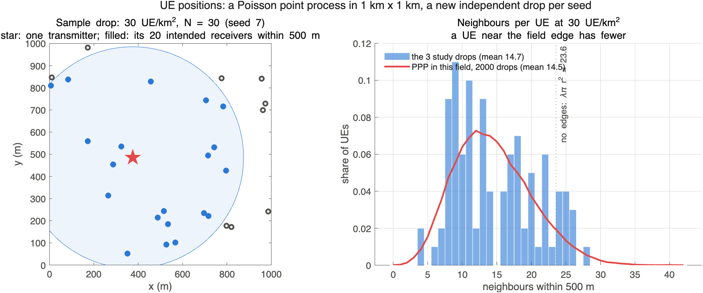

**Figure C.1: One sample drop, and how many neighbours a UE has.** *How to read it:*
- Left: the 30 UE/km² drop of seed 7. The star is one transmitter; filled dots are its 20 intended
  receivers within 500 m.
- Right: the neighbour count across the three study drops at 30 UE/km² (bars), against 2000
  simulated PPP drops of the same field (red). They agree, which confirms the drop is a PPP. The
  dotted line is the edge-free value λπr².

**How a UE carries five flows, and what it costs.** The simulator gives each UE one grant, and its
MAC multiplexes all five flows into it in priority order. Two consequences shape everything below:

- **Every transmission fills the whole channel.** The grant is sized for one reservation period of
  all five flows (about 1100 B). The widest transport block at MCS 11 holds 896 B, so all 5
  sub-channels are taken: measured, 361 of 361 transmissions in a sample run. Two UEs therefore
  never share a slot side by side in frequency; any two transmissions in the same slot collide.
- **The grant is reselected often.** The 10, 20 and 25 ms flows (PQIs 55, 56, 57) often cannot wait
  for the next reserved slot of a 100 ms grant, and each such packet forces a reselection: about 6.5
  per UE per second. A grant therefore lives ~150 ms, not the ~1.6 s of Part A's single-flow SPS,
  and sensing has less advance notice to work with.

A real UE could hold several grants, one per flow class. That is outside this simulator, and it is
the first thing to change for a deployment carrying 10 ms traffic.

## C.2 Reliability, each flow against its own target

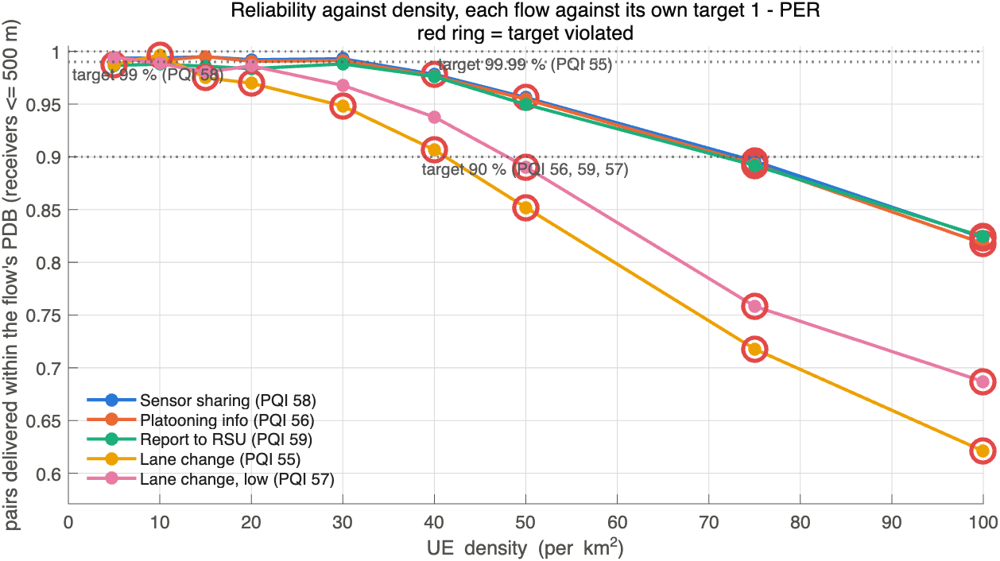

**Figure C.2: Share of (packet, receiver) pairs delivered within the PDB, against density.** *How to
read it:* each line is a flow; the dotted lines are the three targets (99.99 % for PQI 55, 99 % for
PQI 58, 90 % for PQIs 56, 57 and 59); a red ring marks a violated target.

| Density | PQI 58 (99 %) | PQI 56 (90 %) | PQI 59 (90 %) | PQI 55 (99.99 %) | PQI 57 (90 %) |
|---|---|---|---|---|---|
| 5 /km² | 99.37 % PASS | 99.38 % PASS | 98.68 % PASS | 98.76 % **FAIL** | 99.44 % PASS |
| 10 /km² | 99.37 % PASS | 99.15 % PASS | 98.77 % PASS | 99.65 % **FAIL** | 98.85 % PASS |
| 15 /km² | 99.49 % PASS | 99.50 % PASS | 98.59 % PASS | 97.50 % **FAIL** | 98.02 % PASS |
| 20 /km² | 99.20 % PASS | 99.06 % PASS | 98.36 % PASS | 96.98 % **FAIL** | 98.63 % PASS |
| 30 /km² | 99.30 % PASS | 99.13 % PASS | 98.81 % PASS | 94.82 % **FAIL** | 96.78 % PASS |
| 40 /km² | 97.82 % **FAIL** | 97.64 % PASS | 97.61 % PASS | 90.66 % **FAIL** | 93.78 % PASS |
| 50 /km² | 95.62 % **FAIL** | 95.46 % PASS | 94.97 % PASS | 85.19 % **FAIL** | 89.04 % **FAIL** |
| 75 /km² | 89.60 % **FAIL** | 89.30 % **FAIL** | 89.19 % **FAIL** | 71.78 % **FAIL** | 75.84 % **FAIL** |
| 100 /km² | 82.33 % **FAIL** | 81.78 % **FAIL** | 82.42 % **FAIL** | 62.11 % **FAIL** | 68.70 % **FAIL** |

**The PER decides the verdict.** PQIs 58, 56 and 59 ride the same grant and are delivered almost
equally well, yet their verdicts differ. By linear interpolation between the measured densities, each
flow holds its target up to:

| Flow | Target | Holds up to |
|---|---|---|
| PQI 56 (platooning information) | 90 % | ~72 UE/km² |
| PQI 59 (report to RSU) | 90 % | ~71 UE/km² |
| PQI 57 (lane change, lower automation) | 90 % | ~48 UE/km² |
| PQI 58 (sensor sharing) | 99 % | ~32 UE/km² |
| PQI 55 (lane change) | 99.99 % | not met at any density |

Proving 10<sup>−4</sup> for PQI 55 would also need at least 30 000 samples per point. The densities
below 50 UE/km² have fewer.

The lane-change events (55, 57) are the weakest flows at every density. Their first transmission is a
one-shot selection that no neighbour was told about, so sensing cannot protect it (Part A.5).

## C.3 Latency

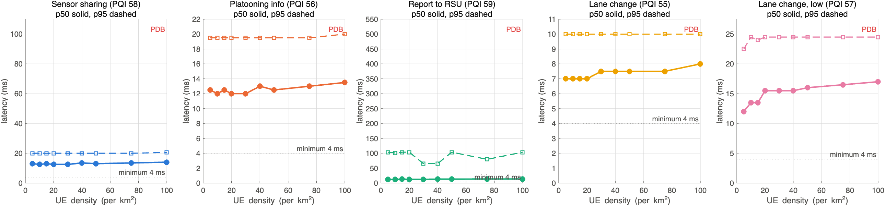

**Figure C.3: Median (solid) and 95th-percentile (dashed) latency of delivered packets, against
density.** The grey dotted line is the 4 ms floor.

| Flow | PDB | Median | 95th percentile |
|---|---|---|---|
| PQI 58 | 100 ms | 12.5–14 ms | 20–20.5 ms |
| PQI 56 | 20 ms | 12–13.5 ms | 19.5–20 ms |
| PQI 59 | 500 ms | 12–13.5 ms | 65–104 ms |
| PQI 55 | 10 ms | 7–8 ms | 10 ms |
| PQI 57 | 25 ms | 12–17 ms | 22.5–24.5 ms |

- **Latency hardly changes with density.** Contention shows up as **lost packets**, not slower ones.
  A packet that collides on both transmissions is gone; it is not delivered late.
- **The long-PDB flows leave much earlier than their own window allows.** PQI 58's median is 13 ms
  against a 52 ms window mean (Part A). These flows ride grants that the short-PDB flows keep
  reselecting with short windows.
- **Every flow's 95th percentile stays at or under its PDB**, as the expiry rule guarantees.

## C.4 Throughput: what broadcast delivers with sensing running

A broadcast transmission has many receivers, so its throughput is counted where it is used, **at the
receivers**:
- every copy of a packet that reaches an intended receiver (within 500 m) within its PDB adds that
  packet's bits;
- **ideal** is every intended receiver getting every packet;
- **per UE** is the field total divided by the number of UEs: what an average UE receives on time.

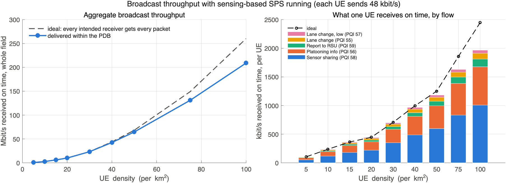

**Figure C.4: Broadcast throughput against density.** *How to read it:*
- Left: the whole field, delivered on time against ideal.
- Right: what one UE receives on time, split by flow; the dashed line is ideal.

| Density | UEs | Ideal (field) | Delivered on time (field) | Received per UE | Efficiency |
|---|---|---|---|---|---|
| 5 /km² | 6 | 0.67 Mbit/s | 0.66 Mbit/s | 105 kbit/s | 99.3 % |
| 10 /km² | 12 | 2.76 Mbit/s | 2.74 Mbit/s | 234 kbit/s | 99.3 % |
| 15 /km² | 17 | 6.19 Mbit/s | 6.14 Mbit/s | 361 kbit/s | 99.3 % |
| 20 /km² | 23 | 10.1 Mbit/s | 10.0 Mbit/s | 442 kbit/s | 98.9 % |
| 30 /km² | 33 | 23.6 Mbit/s | 23.3 Mbit/s | 699 kbit/s | 98.8 % |
| 40 /km² | 44 | 43.8 Mbit/s | 42.6 Mbit/s | 967 kbit/s | 97.1 % |
| 50 /km² | 55 | 68.3 Mbit/s | 64.7 Mbit/s | 1183 kbit/s | 94.6 % |
| 75 /km² | 80 | 149 Mbit/s | 131 Mbit/s | 1631 kbit/s | 87.9 % |
| 100 /km² | 106 | 260 Mbit/s | 209 Mbit/s | 1967 kbit/s | 80.4 % |

How to read these numbers:

- **Every UE transmits 48 kbit/s at every density**, and nearly all of it is sent. What changes is
  how many receivers get it in time.
- **Broadcast throughput grows with density, because every transmission is heard by more
  receivers.** One 48 kbit/s transmitter with 26 neighbours (50 UE/km²) provides ~1.2 Mbit/s of
  useful reception.
- **Efficiency (delivered ÷ ideal) is the cost of sharing.** It stays above 98.8 % up to 30 UE/km²,
  then falls to 94.6 % at 50 and 80.4 % at 100. At 100 UE/km² a fifth of the copies that should
  arrive are lost to collisions and half duplex.
- **Part B's 14.3 Mbit/s for MCS 11 is one link holding the whole channel.** Here each UE uses about
  0.3 % of that rate as a transmitter. The field is limited by collisions, not by link capacity.

## C.5 Collisions and channel load

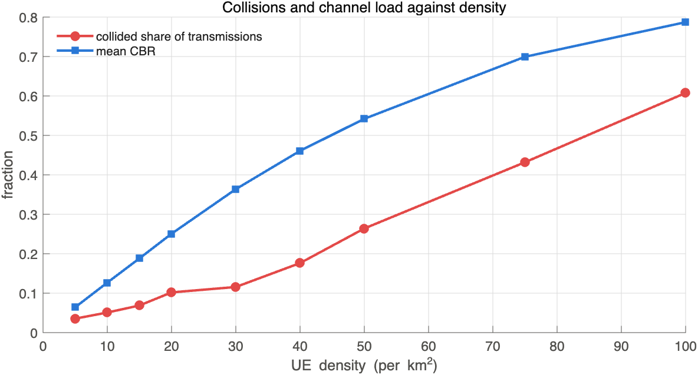

**Figure C.5: Share of transmissions that collided, and mean channel busy ratio (CBR).**

| Density | 5 | 10 | 15 | 20 | 30 | 40 | 50 | 75 | 100 |
|---|---|---|---|---|---|---|---|---|---|
| Collided transmissions | 3.5 % | 5.1 % | 6.9 % | 10.2 % | 11.6 % | 17.6 % | 26.4 % | 43.2 % | 60.8 % |
| Mean CBR | 0.06 | 0.13 | 0.19 | 0.25 | 0.36 | 0.46 | 0.54 | 0.70 | 0.79 |

A collision here means two transmissions in the same slot sharing at least one sub-channel, anywhere
in the field. Because every transmission spans the full channel, any two in the same slot collide.
Most are between UEs far enough apart that each receiver still decodes the nearer one. That is why
61 % collided transmissions turn into 18 % lost copies for the periodic flows and 31–38 % for the
events.

## C.6 Why packets fail

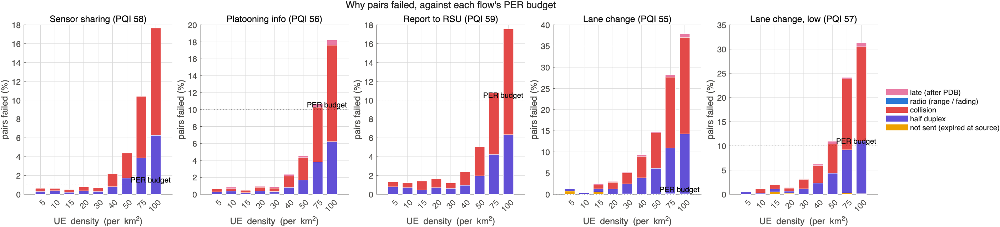

**Figure C.6: Failed pairs by cause, against each flow's PER budget (dotted line).**

| Cause | Share of failures |
|---|---|
| **Collision**: a transmission shared slot and sub-channel with another and was not decoded | 37–67 % (from 15 UE/km²) |
| **Half duplex**: the receiver was itself transmitting in every slot the packet was sent | 30–60 % (from 15 UE/km²) |
| Late: decoded only on a retransmission after the PDB | 0–22 % (mostly PQI 56, 20 ms) |
| Not sent: expired at the sender before a resource came up | under 1 % above 20 UE/km²; a few PQI 55/57 events at 5–20 UE/km² |
| Radio: clean, but too far or faded | 0 % (MCS 11 reaches ~1180 m; receivers are within 500 m) |

- **Contention causes every loss.** The radio link is never the limit inside 500 m.
- **Half duplex and collisions are about equal** at every density. Each UE transmits often (five
  flows, ~6.5 reselections a second), and while it transmits it cannot hear.

## C.7 Reliability against distance

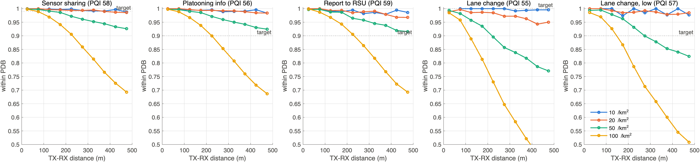

**Figure C.7: Share delivered within the PDB against sender–receiver distance**, for 10, 20, 50 and
100 UE/km².

- **Near the sender every flow is reliable at every density:** within ~50 m every flow delivers at
  least 98 %, because the sender is far louder than any interferer.
- **Reliability falls with distance**, because the further the receiver, the more interferers are as
  loud as the wanted signal.

**The usable range of a flow in a crowded field is set by density, not by the MCS.**

## C.8 Part C in one paragraph

With every UE carrying all five broadcast PQIs at 48 kbit/s:
- **The 90 % flows hold their targets** up to about 70 UE/km² (PQIs 56, 59) and 48 UE/km²
  (PQI 57).
- **The 99 % sensor-sharing flow (PQI 58)** holds to about 32 UE/km².
- **The 99.99 % lane-change flow (PQI 55)** is not met at any density.
- **Broadcast throughput** reaches every intended receiver with ≥ 98.8 % efficiency up to
  30 UE/km² (23 Mbit/s of on-time reception in the field, ~0.7 Mbit/s per UE). Efficiency falls to
  80 % at 100 UE/km².
- **Latency** stays near the bottom of each window and does not grow with density. Contention costs
  packets, not time.
- **Every loss is a collision or half duplex.** Two properties of carrying five flows on one grant
  make both worse: every transmission spans the whole 20 MHz, and the short-PDB flows reselect the
  grant ~6 times a second.

The levers for the 99 % and 99.99 % flows are therefore:
- separate grants per flow class;
- more retransmissions for the tight flows only;
- congestion control (the sl-CR-Limit response to CBR);
- more spectrum.

---

## Assumptions and limits

- **Propagation is TR 38.901 RMa, line of sight.** RMa is specified for base-station heights of
  10–150 m; here both ends are at 3 m. That is outside its stated range, but it is the standard rural
  model and its two-slope shape (20 then 40 dB per decade) is physical. There is no shadowing or
  obstruction: an open field.
- **Antenna height (3 m) and gain (3 dBi each) are deployment assumptions** for agricultural
  machinery. The noise figure (9 dB) is TR 37.885 V15.3.0 Table 6.1.1-1.
- **Speed is the relative speed of the link** and enters through the Doppler of the fading channel.
- **Part B latency has no other users**; contention appears only in Part C.
- **One grant per UE in Part C.** All of a UE's flows share one sidelink grant, sized for all of them.
  A real UE may run several; see C.1.
- **Latency counts 3 slots after the transmission slot** (1 on the air, 2 to receive), and no
  packet is transmitted sooner than T<sub>proc,1</sub> after it arrives.
- **Part C's PHY is abstracted** through the BLER tables Part B measured (at 20 mph), because a
  1 km² field of up to 100 UEs cannot be simulated sample by sample in reasonable time. A separate
  waveform-level check of this abstraction (archived report, §12) found it accurate to about 1 dB.
- **One known deviation from the spec is open:** the PSSCH resource mapping starts at the first DM-RS
  symbol rather than at `sl-StartSymbol + 1` (TS 38.214 §8.1.2.1). It slightly understates the data
  capacity of wide allocations. Fixing it is a normative change awaiting approval.

## Reproducing every number

```matlab
experiments.runStudy()                 % measure (if needed) -> Part B -> Part A -> Part C
experiments.runStudy([], {'B'})        % one part
```

| Part | Function | Figures |
|---|---|---|
| A | `experiments.macTutorial` | `plots/study/A_mac/` |
| B | `experiments.linkLevel` (BLER from `experiments.measureSpeeds`) | `plots/study/B_link/` |
| C | `experiments.systemLevel` | `plots/study/C_system/` |

The operating point and the link (path loss, antenna height and gain, noise figure) are in
`+experiments/settings.m`. The previous, more detailed study is kept in
`archive/REPORT_v1_detailed.md`.

## Glossary

| Term | Meaning |
|---|---|
| Mode 2 | sidelink resource allocation where each UE selects its own resources |
| PDB / PER | packet delay budget / packet error rate allowed; a late packet counts as an error |
| PQI | PC5 QoS identifier: a row of TS 23.287 Table 5.4.4-1 fixing PDB, PER and priority |
| SCI-1A | first-stage control message; announces where the sender transmits and reserves |
| TRIV / FRIV | SCI fields giving the time / frequency of the chained retransmission |
| L<sub>subCH</sub> | number of sub-channels a transmission occupies |
| S<sub>A</sub> | candidate set after exclusion |
| T1, T2 | start and end of the selection window, in slots after the packet's arrival |
| SPS | semi-persistent scheduling: the same resource reused every reservation period |
| P<sub>rsvp</sub> | reservation period |
| RSRP | reference signal received power, per resource element |
| CBR | channel busy ratio: share of sub-channels sensed busy in the last 100 ms |
| MCS | modulation and coding scheme |
| BLER | block error rate: share of transport blocks failing LDPC decoding or the CRC |
