# Latency, Throughput, Range and Channel Capacity of 3GPP Rel-16 NR Sidelink Mode 2

*A simulation study on a clause-cited, spec-verified NR V2X protocol stack (`nrSidelink`)*

19 October 2026

---

## Abstract

We measure what an NR sidelink (3GPP Release 16, resource-allocation Mode 2) delivers to vehicular
applications: how late packets arrive, how many bits per second a link carries, how far it reaches,
and how much transmission capacity a vehicle still has once the channel is busy. Everything runs at
one operating point: a 20 MHz ITS channel at 30 kHz subcarrier spacing (numerology μ = 1) divided
into 5 sub-channels of 10 resource blocks, 23 dBm transmit power, and the TR 38.901 Rural-Macro
(RMa) path-loss model. The physical layer is not approximated by a formula. Block error rates come
from the real transmit and receive chains (LDPC, CRC, DM-RS channel estimation) over a moving
TDL-D fading channel.

Six results stand out. **(1) Latency is decided by the scheduler's selection window, not by the
radio.** A 100 ms-budget message waits about 50 ms for its resource whatever the channel, and
capping the window halves that. **(2) Reliability, not latency, fails first under load.** At
120 vehicles in 0.25 km² (channel busy ratio 0.81) both message types miss their delay budget at the
required 90 % reliability. **(3) Range is set by the MCS and the propagation model.** Under RMa,
MCS 5 reaches 575 m on a single transmission (sensitivity −87.2 dBm over 50 PRB). A field
measurement of 1400 m matches the same receiver under free-space loss within 0.4 dB, which places
the discrepancy in the RMa model at low antenna heights, not in the radio. **(4) High-order
modulation is limited by Doppler, not by noise.** MCS 27 never decodes on a first transmission at
120 km/h with two DM-RS symbols; four DM-RS symbols or 30 km/h restore it. **(5) The remaining
capacity a vehicle may use falls as a staircase with CBR**, from the whole pool below CBR 0.2 to
5 % of it above 0.8, exactly as the configured `sl-CR-Limit` dictates. **(6) Summed waveforms
through real hardware models confirm the PHY abstraction to about 1 dB, and expose what it hides.**
In a 31-vehicle deployment simulated sample by sample, real transmitter and receiver impairments
cost only about 0.25 dB, while the full stack's dynamic-grant MAC (27 % of transmissions collide)
and its PDCP reordering hold (late event messages) push both flows below their 90 % target.

---

## Contents

1. [Introduction](#1-introduction)
2. [System model](#2-system-model)
3. [Method](#3-method)
4. [Slot structure: what goes on air](#4-slot-structure-what-goes-on-air)
5. [Received power, sensitivity and range](#5-received-power-sensitivity-and-range)
6. [Throughput](#6-throughput)
7. [Latency](#7-latency)
8. [Channel busy ratio and remaining capacity](#8-channel-busy-ratio-and-remaining-capacity)
9. [A busy field: many vehicles, periodic and event traffic](#9-a-busy-field-many-vehicles-periodic-and-event-traffic)
10. [Which strategy serves event-driven data best](#10-which-strategy-serves-event-driven-data-best)
11. [HARQ and RLC segmentation](#11-harq-and-rlc-segmentation)
12. [Waveform-level deployment with real hardware](#12-waveform-level-deployment-with-real-hardware)
13. [Every violated packet delay budget](#13-every-violated-packet-delay-budget)
14. [What moves what: factor summary](#14-what-moves-what-factor-summary)
15. [Validity, limitations and defects found](#15-validity-limitations-and-defects-found)
16. [Conclusions and recommendations](#16-conclusions-and-recommendations)
17. [Reproducing every number](#17-reproducing-every-number)
- [Appendix A: Glossary](#appendix-a-glossary)

---

## 1. Introduction

Vehicles exchange two kinds of safety messages over the sidelink. **Cooperative Awareness Messages
(CAMs)** are periodic: every vehicle broadcasts its position and speed, here every 100 ms. **Event
messages** (DENM-like warnings, sensor alerts) appear when something happens, at random times, and
must arrive faster. In NR Mode 2 there is no base station deciding who transmits when. Each vehicle
listens to the channel, works out which resources its neighbours have reserved (*sensing*), and
picks a free one itself (*resource selection*). Whether that works depends on how crowded the
channel is, how far the vehicles are apart, which modulation and coding scheme (MCS) they use, and
a handful of implementation choices the standard leaves open.

The questions this report answers:

- **Latency.** How long from message creation to reception, and does it stay inside the packet
  delay budget (PDB)?
- **Throughput.** How many bits per second does a link carry at each MCS, and at what distance?
- **Range and sensitivity.** What received power does each MCS need, and how far does that reach?
- **Remaining capacity.** As the channel busy ratio (CBR) rises, how much may a vehicle still
  transmit?
- **What to do about it.** Which settings serve event-driven traffic best, and when does each
  configuration break its delay budget?

## 2. System model

### 2.1 Operating point

Every experiment runs at the same point. The suite asserts it before every system-level run and
checks it on every link-level measurement, so no result can silently come from a different
configuration.

| Parameter | Value | Note |
|---|---|---|
| Channel bandwidth | **20 MHz** | the ITS channel at 5.9 GHz |
| Subcarrier spacing | **30 kHz**, numerology **μ = 1** | slot = 0.5 ms, 14 OFDM symbols |
| Resource pool | **5 sub-channels × 10 PRB = 50 PRB** | 18 MHz occupied; TS 38.101-1 allows 51 PRB in 20 MHz at 30 kHz |
| Transmit power | **23 dBm** | P<sub>CMAX</sub>, full power always |
| Path loss | **TR 38.901 RMa, line of sight** | antennas 1.5 m; see §5.4 |
| Fading | TDL-D, 100 ns delay spread, 120 km/h Doppler speed | two vehicles at 60 km/h |
| Noise | thermal, noise figure 9 dB | −120.2 dBm per 30 kHz resource element |
| Carrier | 5.9 GHz | |

### 2.2 Traffic and quality of service

QoS follows TS 23.287 Table 5.4.4-1. Each flow has a **PDB** and a **packet error rate (PER)**,
and the two are a pair: a packet that arrives after its PDB counts as an error.

| Flow | PQI | PDB | PER (→ reliability target) | Priority | Generation | Size |
|---|---|---|---|---|---|---|
| CAM (periodic awareness) | 55 | 100 ms | 10 % (→ 90 % on time) | 6 | every 100 ms | 300 B |
| Event (warning) | 70 | 20 ms | 10 % (→ 90 % on time) | 3 | Poisson, mean 500 ms per vehicle | 250 B |

### 2.3 The radio procedure being simulated

- **Sensing and selection** (TS 38.214 §8.1.4). Every vehicle decodes the control messages
  (SCI-1A) of its neighbours, records which resources they announced, and excludes those heard
  above an RSRP threshold. If too few candidates survive (fewer than `sl-TxPercentage`, 20 %), the
  threshold rises in 3 dB steps. The vehicle then draws a resource at random from the survivors,
  inside a **selection window** [n + T1, n + T2] that ends no later than the remaining PDB.
- **Reservations** (TS 38.321 §5.22.1). A grant repeats every reservation period P<sub>rsvp</sub>
  (100 ms by default) for a random number of periods, and carries one blind retransmission
  resource.
- **HARQ.** In broadcast, the retransmission is sent blind. In unicast, the receiver answers on the
  feedback channel PSFCH, and an acknowledgement cancels the retransmission.
- **Congestion control** (TS 38.214 §8.1.6, TS 38.215). Each vehicle measures CBR and its own
  channel occupancy ratio (CR); the configured `sl-CR-Limit` caps CR as CBR rises.

## 3. Method

### 3.1 Three simulation engines, each used where it is the honest one

| Engine | What is real | What is abstracted | Used for |
|---|---|---|---|
| **Link level** (`+harness/+lls`) | the full PSCCH/PSSCH transmit chain, OFDM waveform, fading channel, DM-RS channel estimation, equaliser, LDPC decoding with HARQ soft combining, CRC check | nothing on the link | BLER curves, sensitivity, throughput vs SNR and distance |
| **System level** (`+harness/+sls`) | Mode-2 MAC: sensing from decoded SCIs, candidate sets, reservations, re-evaluation, pre-emption, PSFCH, CBR/CR, the real MAC receive path | the PHY, through the measured BLER table | latency, field, CBR, strategies, HARQ vs distance |
| **Full stack** (`+harness/+field`) | every layer (SDAP, PDCP, RLC, MAC, PHY) and the waveform for a few vehicles | nothing | RLC segmentation |

### 3.2 How a flow is judged

A flow **passes** when the share of packets delivered within its PDB is at least 1 − PER (90 %
here). Broadcast safety traffic is judged **per link**: every pair of (packet, receiver within
300 m) counts once, and losses to half-duplex (the receiver was itself transmitting) and to
collisions count as failures. The **per-packet** figure (first reception at *any* receiver) is
reported alongside and always looks better, because the nearest neighbour almost always succeeds.

### 3.3 Statistics

System-level points average 3 independent seeds (traffic and placement). Link-level points use
40–80 transport blocks per SNR step, each over its own independent fading realisation. With 40
blocks the finest resolvable BLER is 2.5 %, so "0 %" in a curve means "no error observed", not
"error-free".

---

## 4. Slot structure: what goes on air

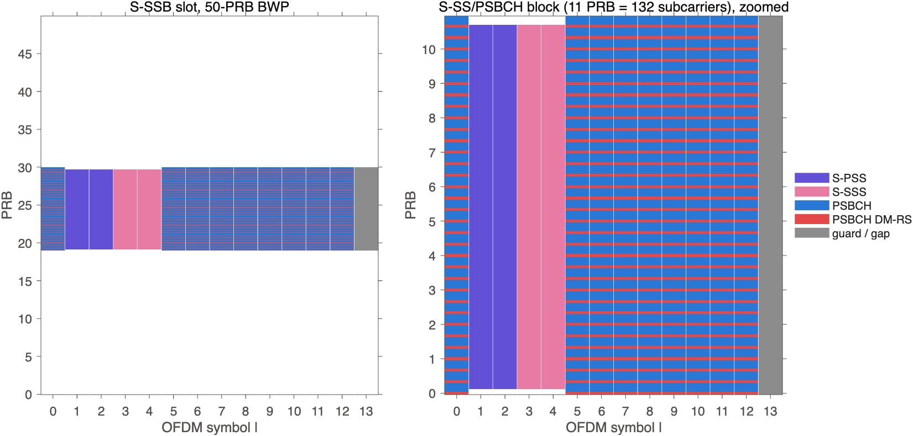

**Figure 4.1: Synchronisation (S-SSB) slot.** *How to read it:* the horizontal axis is the 14 OFDM
symbols of one 0.5 ms slot, the vertical axis is frequency in resource blocks (PRB), and each colour
is a physical signal. The block occupies 11 PRB in the middle of the 50-PRB channel. Symbol 0 is the
PSBCH broadcast channel (it also serves for automatic gain control), symbols 1–2 carry the primary
sync sequence S-PSS, 3–4 the secondary S-SSS, 5–12 the PSBCH with its DM-RS pilots, and 13 is a
guard. A slot carrying S-SSB carries no data, so the resource pool skips it (Figure 4.3).

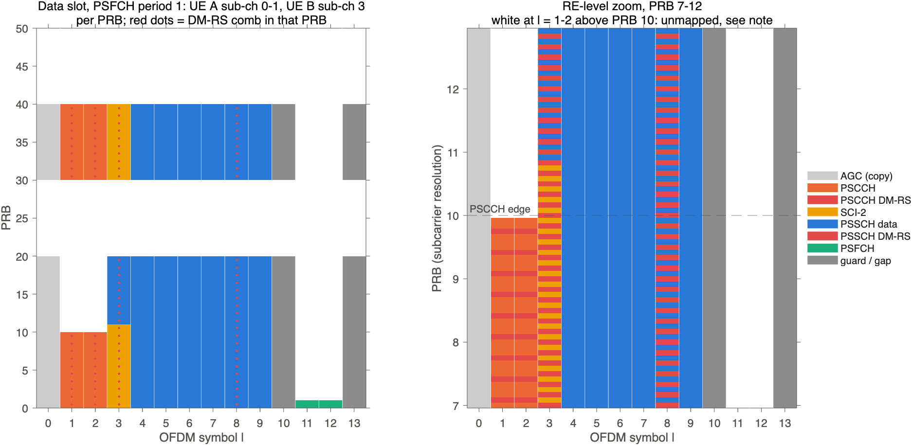

**Figure 4.2: Normal data slot with a feedback (PSFCH) occasion.** Two vehicles transmit in the same
slot on different sub-channels. Symbol 0 is the AGC copy, 1–2 hold the control channel PSCCH (10 PRB
at the bottom of each allocation), the second-stage control SCI-2 starts at symbol 3, data PSSCH
fills the rest, pilots (DM-RS) sit on symbols 3 and 8, symbol 10 is a gap, 11–12 carry the PSFCH
feedback, and 13 is a guard. The right panel zooms to resource-element level.
Without PSFCH (`figures/slot_structure/data_slot_nopsfch.png`) data runs to symbol 12.

**Feedback costs capacity in every slot of the pool, used or not.** At MCS 7 the transport block
(TB) for 1…5 sub-channels is 129 / 301 / 469 / 624 / 784 bytes without PSFCH and 80 / 201 / 317 /
437 / 560 bytes with it: 28–38 % less.

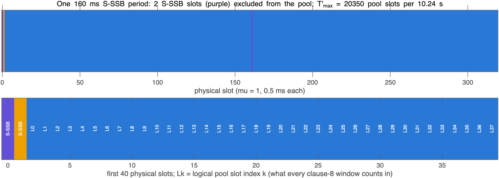

**Figure 4.3: Which slots belong to the resource pool.** Over one 160 ms S-SSB period, the S-SSB
slots are removed from the pool, and the scheduler counts in *logical* pool slots L<sub>k</sub>.
With two S-SSB per 160 ms, 20 350 of 20 480 slots per 10.24 s remain usable.

---

## 5. Received power, sensitivity and range

### 5.1 Definitions

- **Noise per resource element:** N<sub>RE</sub> = −174 dBm/Hz + 10·log10(30 kHz) + 9 dB = **−120.2 dBm**.
- **Received power** P<sub>RX</sub>(d) = 23 dBm − PL(d), spread over the transmission's allocation.
- **SNR per resource element** = P<sub>RX</sub> − 10·log10(12·N<sub>PRB</sub>) − N<sub>RE</sub>. A
  narrower allocation concentrates the same 23 dBm on fewer subcarriers, so it is more robust:
  10 PRB has 7 dB more SNR per RE than 50 PRB at the same distance.
- **Sensitivity** is the received power, over the allocation, at which the transport block
  **survives LDPC decoding and passes its 24-bit CRC** for at least 90 % of blocks (BLER ≤ 10 %,
  matching the 10 % PER of the flows). It is read from the measured BLER curves, not from a bound.

### 5.2 Sensitivity per MCS

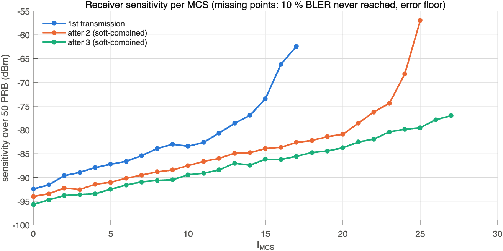

**Figure 5.1: Receiver sensitivity of every MCS** over 50 PRB, for the first transmission and after
two and three soft-combined transmissions. *How to read it:* lower is better; a missing point means
the MCS never reaches 90 % success at that number of transmissions (an error floor).

| MCS | Modulation, code rate | Required SNR/RE (1st TX) | Sensitivity, 50 PRB | Sensitivity, 10 PRB | after 2 TX (50 PRB) | after 3 TX (50 PRB) |
|---|---|---|---|---|---|---|
| 0 | QPSK 0.12 | 0.0 dB | −92.4 dBm | −99.4 dBm | −94.0 dBm | −95.7 dBm |
| **5** | QPSK 0.37 | 5.2 dB | **−87.2 dBm** | **−94.2 dBm** | −91.0 dBm | −92.5 dBm |
| **6** | QPSK 0.44 | 5.8 dB | **−86.6 dBm** | **−93.6 dBm** | −90.2 dBm | −91.6 dBm |
| 7 | QPSK 0.51 | 7.0 dB | −85.4 dBm | −92.4 dBm | −89.5 dBm | −90.9 dBm |
| **11** | 16QAM 0.37 | 9.8 dB | **−82.6 dBm** | **−89.6 dBm** | −86.6 dBm | −89.1 dBm |
| 16 | 16QAM 0.64 | 26.3 dB | −66.2 dBm | −73.2 dBm | −83.6 dBm | −86.2 dBm |
| 20 | 64QAM 0.55 | never | — | — | −80.9 dBm | −83.8 dBm |
| **27** | 64QAM 0.89 | never | — | — | never | −77.0 dBm |

The thermal noise over 50 PRB is −92.4 dBm, so MCS 0 decodes right at the noise floor (0 dB SNR),
and every step up in MCS costs about 1 dB until 16QAM at high code rate, where the fading channel
opens an error floor (§6.2).

### 5.3 Received power against distance

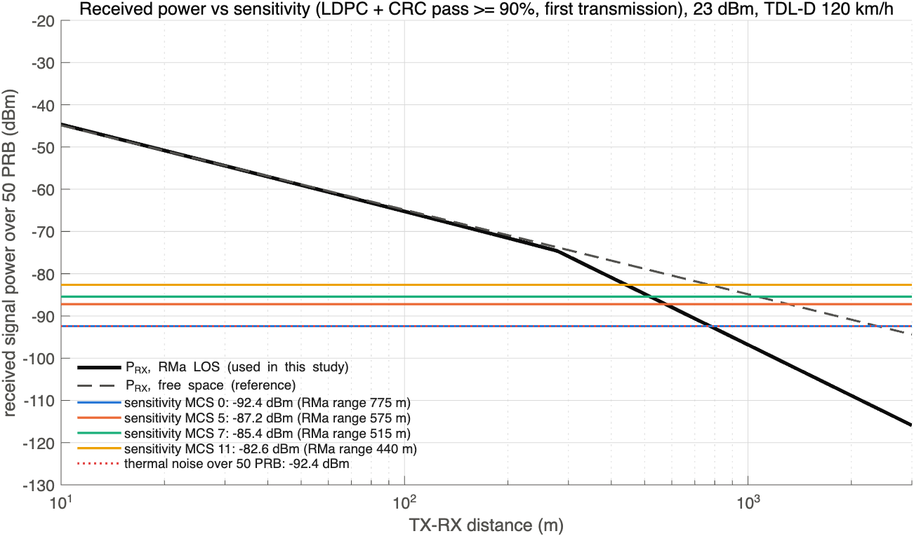

**Figure 5.2: Received power against sensitivity.** *How to read it:* the black line is the power a
receiver gets from a 23 dBm transmitter at each distance (RMa, used in this study), the dashed line
the same under free space. Each coloured horizontal line is an MCS's sensitivity. **A link works
where the black line is above the coloured one; the crossing is the range.**

| MCS | Range, 1st TX, 50 PRB (RMa) | 10 PRB (RMa) | 50 PRB after 3 TX (RMa) | 50 PRB, 1st TX, free space |
|---|---|---|---|---|
| 0 | 775 m | 1160 m | 935 m | 2385 m |
| **5** | **575 m** | 860 m | 775 m | **1310 m** |
| **6** | **550 m** | 825 m | 735 m | 1215 m |
| 7 | 515 m | 775 m | 710 m | 1065 m |
| **11** | **440 m** | 660 m | 640 m | 770 m |
| **27** | **0 m** | 0 m | 315 m | 0 m |

### 5.4 Agreement with field measurement, and why RMa is short

A field measurement gave **1400 m for MCS 5**. Under RMa this study predicts 575 m. The receiver is
not the cause: under free-space loss the same measured MCS 5 curve reaches its sensitivity at
**1310 m**, within 0.4 dB of the field result. The cause is RMa evaluated at 1.5 m antennas. Its
line-of-sight breakpoint, d<sub>BP</sub> = 2π·h<sub>TX</sub>·h<sub>RX</sub>·f<sub>c</sub>/c, is
only **278 m**. Beyond it RMa loses 40 dB per decade instead of 20:

| Distance | Free space | RMa LOS (h = 1.5 m) | RMa excess |
|---|---|---|---|
| 278 m | 96.7 dB | 97.6 dB | 0.8 dB |
| 575 m | 103.1 dB | 110.2 dB | 7.2 dB |
| 1000 m | 107.9 dB | 119.8 dB | 12.0 dB |
| 1400 m | 110.8 dB | 125.7 dB | 14.9 dB |

RMa was retained as the study's specified model. **Read every range in this report as an RMa range;
on an open line-of-sight road the same radio reaches roughly twice as far.** RMa is a
base-station-to-vehicle model whose validity starts at 10 m antenna height; TR 37.885 defines the
vehicle-to-vehicle models a sidelink study should use, and none was available here.

---

## 6. Throughput

### 6.1 What "throughput" means here

The **link throughput** is TBS × (1 − BLER) / (transmissions per TB × 0.5 ms): the rate one link
reaches if it transmits in every slot on the whole 50-PRB channel. It is an upper bound; a vehicle
sharing the pool gets far less (§8). Three HARQ modes are compared: **no HARQ** (one transmission),
**blind retransmission** (always two, as in broadcast) and **PSFCH feedback** (up to three, stopping
at the first acknowledgement, as in unicast; its TBs are smaller because PSFCH takes symbols).

Three channel conditions:
**A** highway, 120 km/h Doppler speed, 2 DM-RS symbols (the default);
**B** the same with 4 DM-RS symbols;
**C** urban, 30 km/h, 2 DM-RS symbols.

### 6.2 MCS 5, 6, 11 and 27

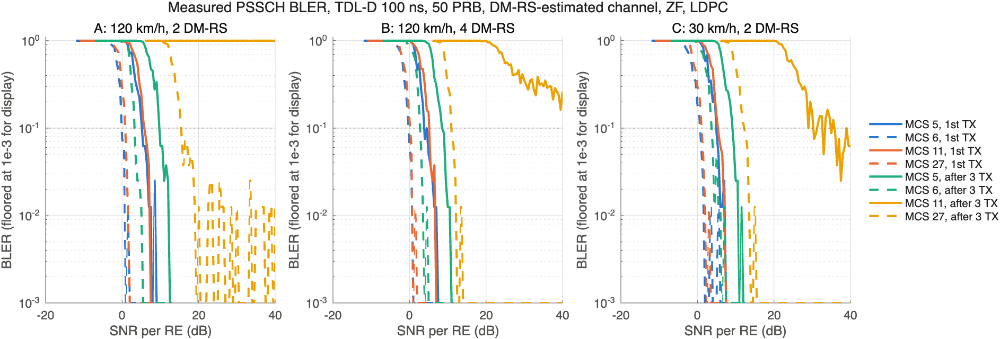

**Figure 6.1: Measured block error rate.** Solid: first transmission; dashed: after three
soft-combined transmissions. *Key point:* MCS 27 never decodes on its first transmission at
120 km/h with 2 DM-RS symbols, at any SNR up to 40 dB. With 4 DM-RS its floor falls to 26 %, at
30 km/h to 6 %. The limit is how fast the channel changes between the pilot symbols (the coherence
time at 120 km/h is about one slot), not the code.

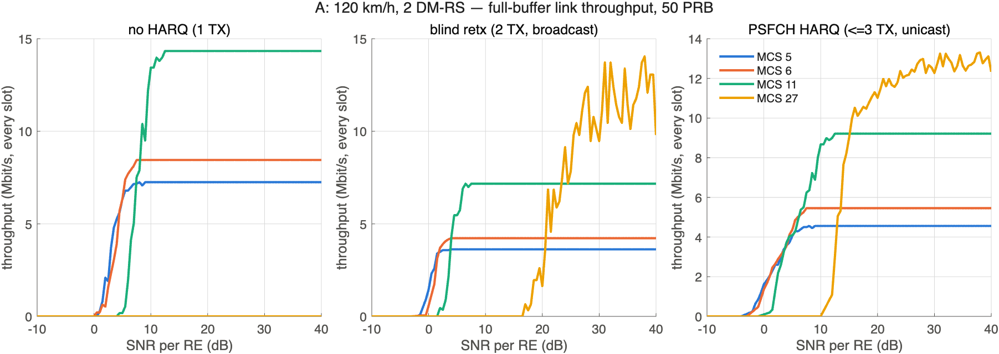

**Figure 6.2: Throughput against SNR, condition A**, for each HARQ mode.

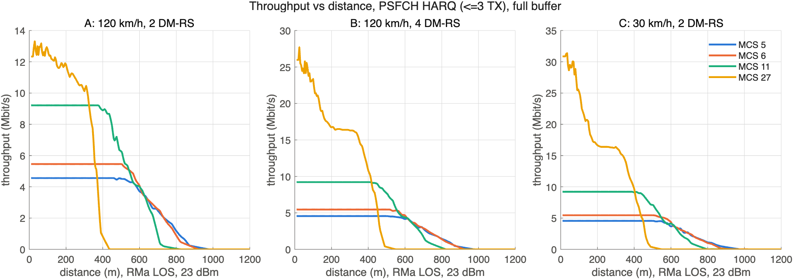

**Figure 6.3: Throughput against distance**, PSFCH HARQ, in each condition.

| MCS | Peak (error-free) | Best achieved, no HARQ: A / B / C | Best with PSFCH HARQ: A / B / C | Range at 90 %, HARQ: A / B / C |
|---|---|---|---|---|
| 5 | 7.2 Mb/s | 7.2 / 7.2 / 7.2 Mb/s | 4.6 / 4.6 / 4.6 Mb/s | 775 / 780 / 740 m |
| 6 | 8.4 Mb/s | 8.4 / 8.4 / 8.4 Mb/s | 5.5 / 5.5 / 5.5 Mb/s | 735 / 765 / 725 m |
| 11 | 14.3 Mb/s | 14.3 / 14.3 / 14.3 Mb/s | 9.2 / 9.2 / 9.2 Mb/s | 640 / 660 / 625 m |
| 27 | 52.2 Mb/s | **0** / 43.8 / 50.9 Mb/s | 13.3 / 27.7 / 31.4 Mb/s | 315 / 410 / 380 m |

*Plainly:* MCS 5 and 6 are robust everywhere and give 7–8 Mb/s. MCS 11 doubles that at about 100 m
less range. MCS 27 promises 52 Mb/s, but on a highway it only works with HARQ combining (13 Mb/s, to
315 m); it needs a slower channel or more pilots to deliver.

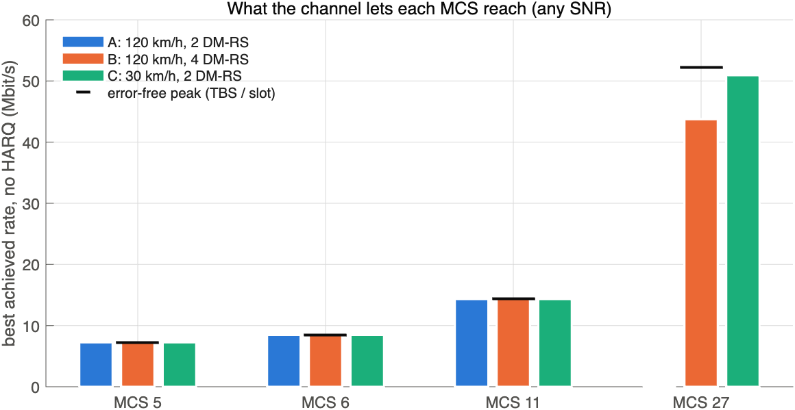

**Figure 6.4: Best achieved rate per MCS and condition**, against the error-free peak.

### 6.3 Every MCS against distance

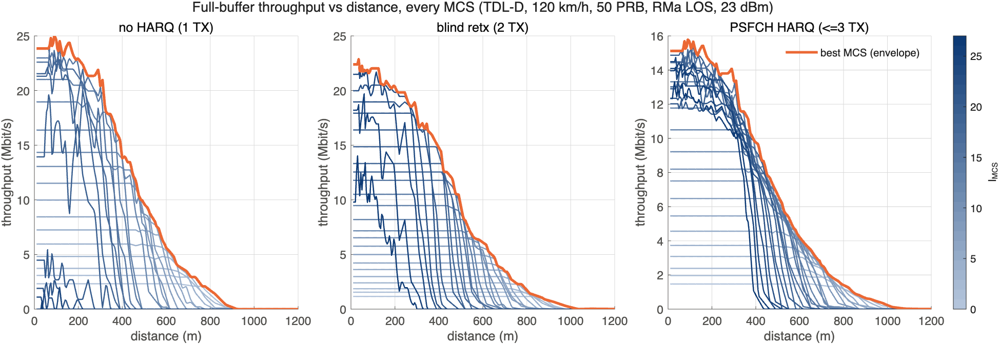

**Figure 6.5: Throughput against distance for all 28 MCS** (condition A). Each thin line is one MCS,
darker = higher MCS. The thick orange line is the **envelope**: what a perfect link adaptation that
always picks the best MCS would get.

| Distance | No HARQ | Blind retransmission | PSFCH feedback |
|---|---|---|---|
| 10 m | 23.8 Mb/s (MCS 17) | 22.4 Mb/s (MCS 25) | 15.1 Mb/s (MCS 17) |
| 100 m | 24.6 (MCS 16) | 22.0 (MCS 24) | 15.5 (MCS 16) |
| 200 m | 22.9 (MCS 15) | 20.4 (MCS 23) | 14.4 (MCS 15) |
| 300 m | 20.4 (MCS 16) | 17.8 (MCS 22) | 13.4 (MCS 16) |
| 400 m | 13.8 (MCS 11) | 14.8 (MCS 20) | 9.8 (MCS 20) |
| 500 m | 9.6 (MCS 7) | 9.5 (MCS 14) | 6.7 (MCS 16) |
| 600 m | 5.6 (MCS 5) | 6.1 (MCS 9) | 4.2 (MCS 8) |
| 700 m | 3.3 (MCS 3) | 3.5 (MCS 6) | 2.6 (MCS 6) |
| 800 m | 1.7 (MCS 0) | 1.7 (MCS 3) | 1.4 (MCS 4) |
| 900 m | 0.2 (MCS 0) | 0.8 (MCS 0) | 0.6 (MCS 1) |

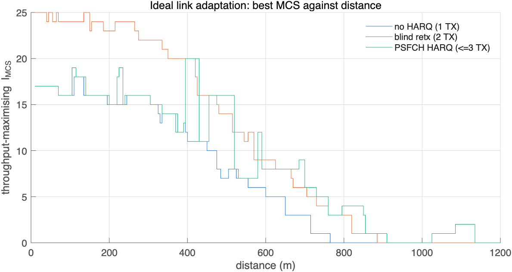
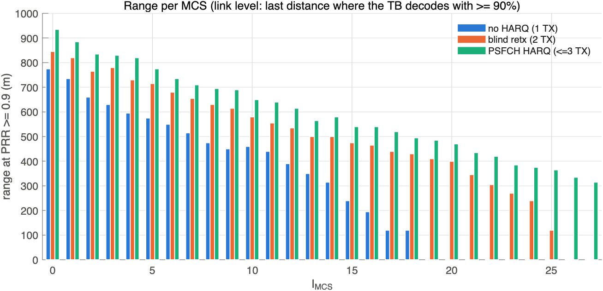

**Figures 6.6–6.7: The best MCS at each distance, and each MCS's range** (last distance with ≥ 90 %
decoding).

---

## 7. Latency

### 7.1 Baseline

Field of 500 m × 500 m, 40 vehicles, MCS 7, P<sub>rsvp</sub> 100 ms, one blind retransmission,
selection window T2 = remaining PDB.

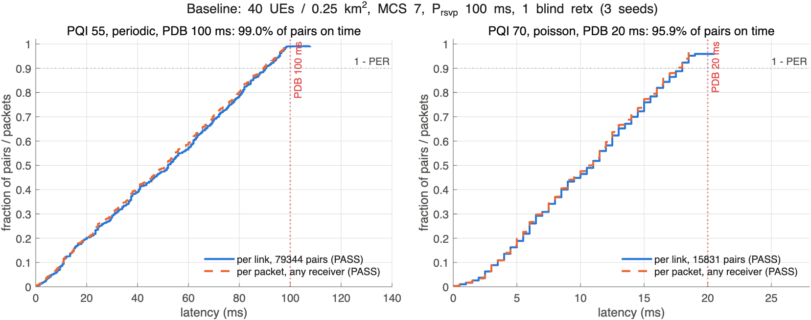

**Figure 7.1: Latency distribution.** *How to read it:* each curve gives, for each latency on the
horizontal axis, the share of (packet, receiver) pairs delivered by then. Lost packets never arrive,
so a curve stops at its on-time share instead of reaching 1. The red line is the PDB.

| Flow | Pairs | Median latency | 95th percentile | Within PDB | Verdict |
|---|---|---|---|---|---|
| CAM (PDB 100 ms) | 79 344 | 52 ms | 94.5 ms | 99.0 % | PASS |
| Event (PDB 20 ms) | 15 831 | 10.5 ms | 18 ms | 95.9 % | PASS |

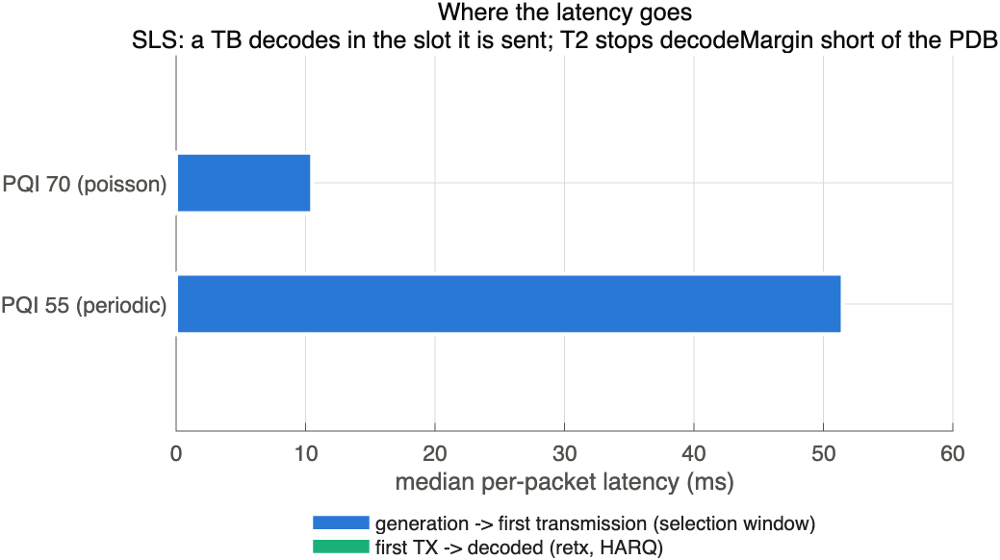

**Figure 7.2: Where the time goes.** Practically all latency is the wait between a message's creation
and its selected resource. The resource is drawn uniformly over a window that runs to the PDB, so a
100 ms message waits about 50 ms on average *however empty the channel is*. The radio itself adds
one slot (0.5 ms).

### 7.2 What changes latency, and what does not

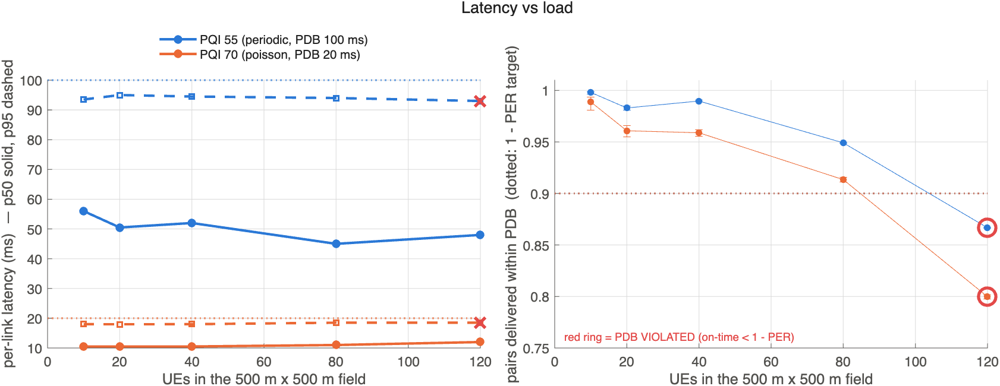

**Figure 7.3: Load.** *How to read it:* the left panel shows median (solid) and 95th-percentile
(dashed) latency, the right panel the share within PDB; red rings mark violations. Latency barely
moves with load, because the window sets it. Reliability collapses:

| Vehicles | CBR | Collided transmissions | CAM within 100 ms | Event within 20 ms |
|---|---|---|---|---|
| 10 | 0.10 | 2.5 % | 99.8 % | 98.9 % |
| 20 | 0.19 | 6.3 % | 98.3 % | 96.1 % |
| 40 | 0.38 | 12.5 % | 99.0 % | 95.9 % |
| 80 | 0.67 | 31.4 % | 94.9 % | 91.3 % (margin 1.3 pt) |
| 120 | 0.81 | 58.4 % | **86.7 % VIOLATED** | **80.0 % VIOLATED** |

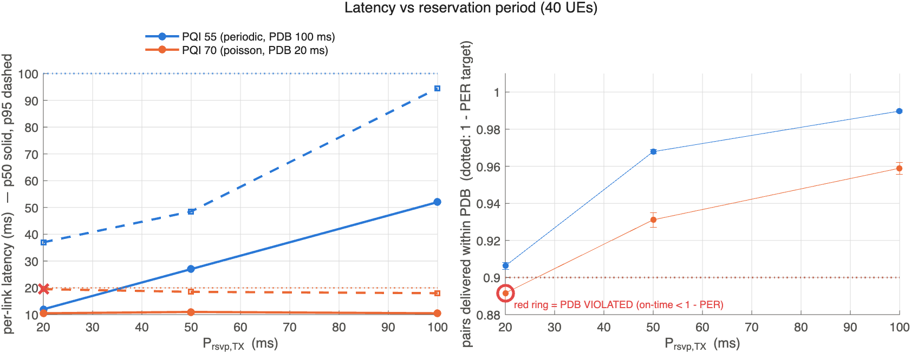

**Figure 7.4: Reservation period.** Shortening P<sub>rsvp</sub> from 100 to 20 ms cuts the CAM median
from 52 to 12 ms, but collisions rise from 12.5 % to 47 % and the **event flow violates its PDB at only
40 vehicles** (89.2 %). *Why:* TS 38.214 §8.1.4 step 6 projects a neighbour's reservation forward
only when its control message is less than one period old. A vehicle that reserves every 20 ms but
sends only every 100 ms emits no control message in between, so when it does transmit, nobody's
sensing expected it. **Rule: never reserve faster than the traffic arrives.**

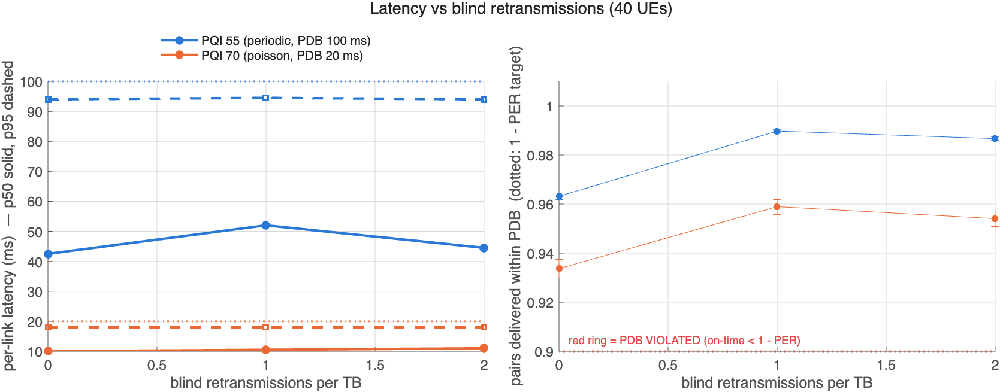

**Figure 7.5: Blind retransmissions.** One retransmission is optimal: event on-time 93.4 % → 95.9 % →
95.4 % for 0 / 1 / 2. Each extra copy raises CBR (0.20 → 0.38 → 0.50) faster than it adds diversity.

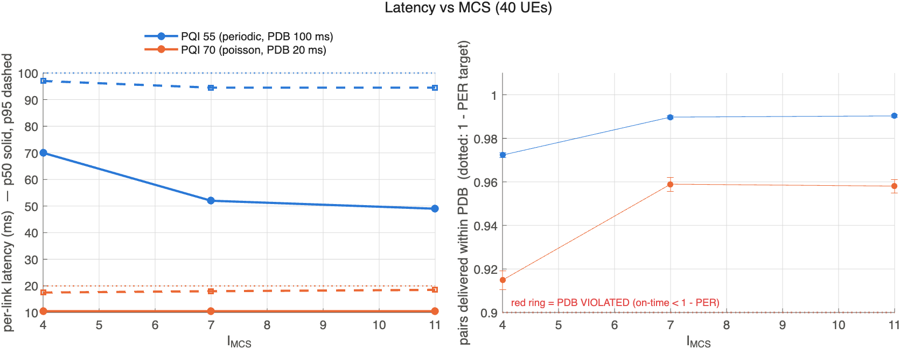

**Figure 7.6: MCS.** MCS 4, 7 and 11 all pass at 40 vehicles. MCS 4 has the least margin (events
91.5 %): its largest TB (372 B) cannot carry a CAM and an event together.

---

## 8. Channel busy ratio and remaining capacity

### 8.1 What the two quantities mean

- **CBR** (TS 38.215 §5.1.25) is what a vehicle *hears*: the share of sub-channels, over the last
  100 ms, whose received energy (S-RSSI) exceeded −94 dBm. It counts everyone's transmissions.
- **CR** (§5.1.26) is what a vehicle *uses*: the share of the pool's sub-channel-slots it occupied
  itself over the last second.
- **The rule** (TS 38.214 §8.1.6): at each CBR level, a vehicle's CR may not exceed `sl-CR-Limit`.
  This pool is configured with limits **1.0 / 0.6 / 0.3 / 0.12 / 0.05** for CBR up to
  **0.2 / 0.4 / 0.6 / 0.8 / 1.0**.

**Remaining capacity** is then what the rule still lets this vehicle send:

&nbsp;&nbsp;&nbsp;&nbsp;remaining = (CR<sub>limit</sub>(CBR) − CR<sub>own</sub>) × pool capacity

The pool capacity at MCS 7 is 5 sub-channels × 2000 slots/s × 124.8 bytes per sub-channel =
**9.98 Mbit/s**. As a second, physical view, the *idle* share of the pool is (1 − CBR) × pool
capacity: not a permission, but what any additional transmission competes for.

### 8.2 Result

Load was swept by vehicle count (20 / 40 / 80) and message period (100 / 50 / 20 ms, 300 B CAM) to
spread CBR from 0.1 to 0.95. Every vehicle sampled its CBR and CR every 10 ms, after both
measurement windows had filled.

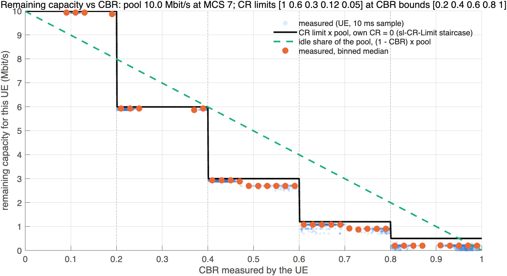

**Figure 8.1: Remaining capacity against CBR.** *How to read it:* the black staircase is the
configured rule for a vehicle that has used nothing yet; the dashed green line is the idle share of
the pool; blue dots are individual measurements; orange dots their median per CBR bin.

The measurements sit on the staircase, a little below each step because each vehicle's own CR is
subtracted:

| CBR range | CR limit | Remaining capacity (CR<sub>own</sub> ≈ 0) | Measured median | Idle share of pool |
|---|---|---|---|---|
| 0 – 0.2 | 1.00 | 9.98 Mbit/s | 9.9 Mbit/s | 10.0 → 8.0 Mbit/s |
| 0.2 – 0.4 | 0.60 | 5.99 Mbit/s | 5.9 Mbit/s | 8.0 → 6.0 Mbit/s |
| 0.4 – 0.6 | 0.30 | 2.99 Mbit/s | 2.7 – 2.9 Mbit/s | 6.0 → 4.0 Mbit/s |
| 0.6 – 0.8 | 0.12 | 1.20 Mbit/s | 0.9 – 1.1 Mbit/s | 4.0 → 2.0 Mbit/s |
| 0.8 – 1.0 | 0.05 | 0.50 Mbit/s | 0.2 Mbit/s | 2.0 → 0 Mbit/s |

*Plainly:* below CBR 0.2 a vehicle may use the whole channel. Each CBR step halves or worse what it
may send, and above CBR 0.8 it is down to about 0.2 Mbit/s, less than one 300 B message every
10 ms. Between CBR 0.2 and 0.6 the rule is *stricter* than the idle share (the staircase sits below
the dashed line): congestion control holds vehicles back before the channel is physically full,
which is its purpose.

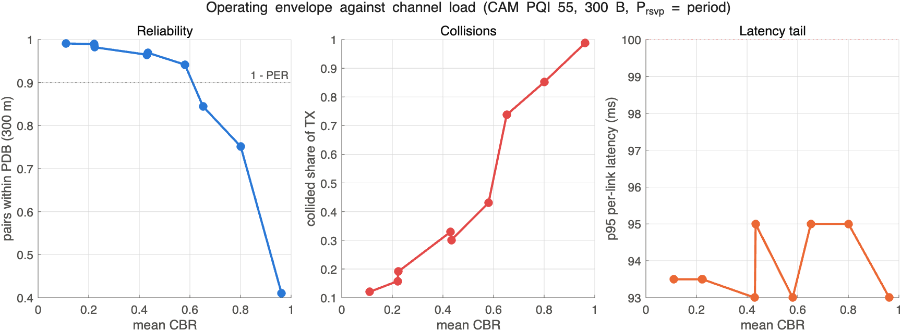

**Figure 8.2: The operating envelope.** On-time delivery, collision rate and 95th-percentile latency
against mean CBR.

| Load | CBR | Own CR | Remaining (rule) | On time (per link) | Collided TX | Verdict |
|---|---|---|---|---|---|---|
| 20 vehicles, every 100 ms | 0.11 | 0.006 | 9.9 Mbit/s | 99.1 % | 12 % | PASS |
| 20, 50 ms | 0.22 | 0.012 | 5.9 Mbit/s | 98.9 % | 16 % | PASS |
| 40, 100 ms | 0.22 | 0.006 | 5.9 Mbit/s | 98.2 % | 19 % | PASS |
| 80, 100 ms | 0.43 | 0.006 | 2.9 Mbit/s | 96.5 % | 33 % | PASS |
| 40, 50 ms | 0.43 | 0.012 | 2.9 Mbit/s | 96.9 % | 30 % | PASS |
| 20, 20 ms | 0.58 | 0.033 | 2.7 Mbit/s | 94.2 % | 43 % | PASS |
| 80, 50 ms | 0.65 | 0.012 | 1.1 Mbit/s | **84.5 %** | 74 % | **VIOLATED** |
| 40, 20 ms | 0.80 | 0.034 | 0.16 Mbit/s | **75.2 %** | 85 % | **VIOLATED** |
| 80, 20 ms | 0.96 | 0.034 | 0.16 Mbit/s | **41.0 %** | 99 % | **VIOLATED** |

**The usable limit of this channel is CBR ≈ 0.6.** Below it the CAM flow stays above its 90 %
target; above it collisions dominate (74–99 % of transmissions) and the CAM flow fails its delay
budget. Note that congestion control dropped only one transmission in all these
runs: each vehicle's own CR (0.006–0.034) stays far below its limit, so the rule never binds, and
nothing stops the collisions. A congestion response that reacts to CBR directly (fewer
retransmissions, a higher MCS) rather than only to the CR limit would be needed to defend the
region above 0.6.

---

## 9. A busy field: many vehicles, periodic and event traffic

Vehicles are placed as a **Poisson point process** (160 per km², which gave 31 vehicles in
500 m × 500 m) and run for 10 s. Each sends CAMs and Poisson event messages. The **target** is the
vehicle nearest the centre.

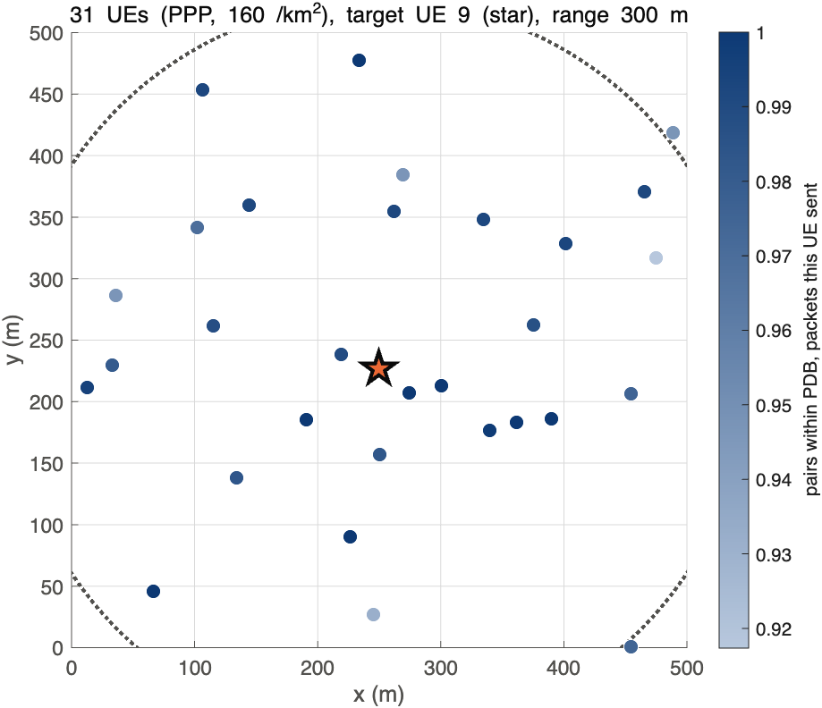

**Figure 9.1: The drop.** Each vehicle is coloured by the on-time share of the messages it sent; the
star is the target, the circle its 300 m receive range.

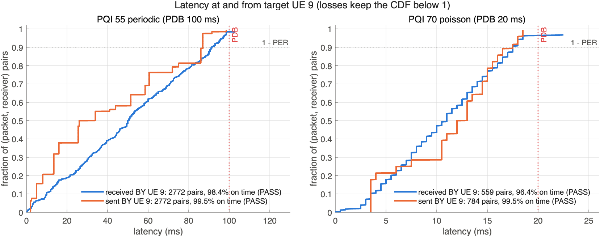

**Figure 9.2: Latency at and from the target.** Messages the target receives arrive on time in
98.4 % (CAM) and 96.4 % (event) of cases; its own messages reach its neighbours on time in 99.5 %
(CAM) and 99.5 % (event) of cases.

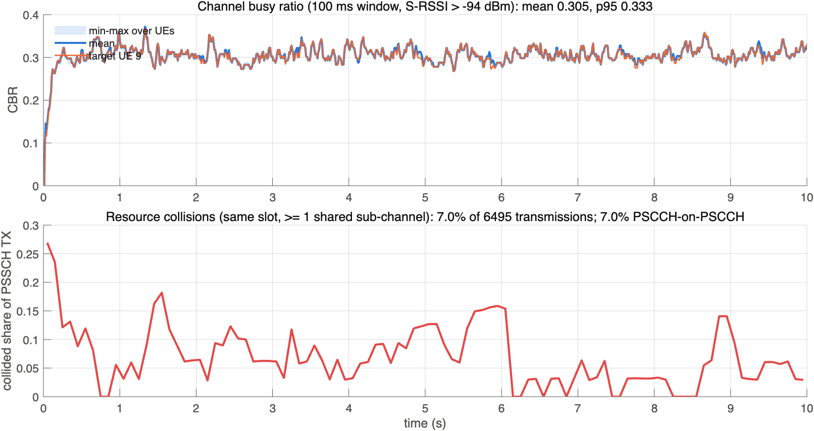

**Figure 9.3: Channel load over time.** Mean CBR 0.31 (95th percentile 0.33); 7.0 % of 6 495
transmissions collide.

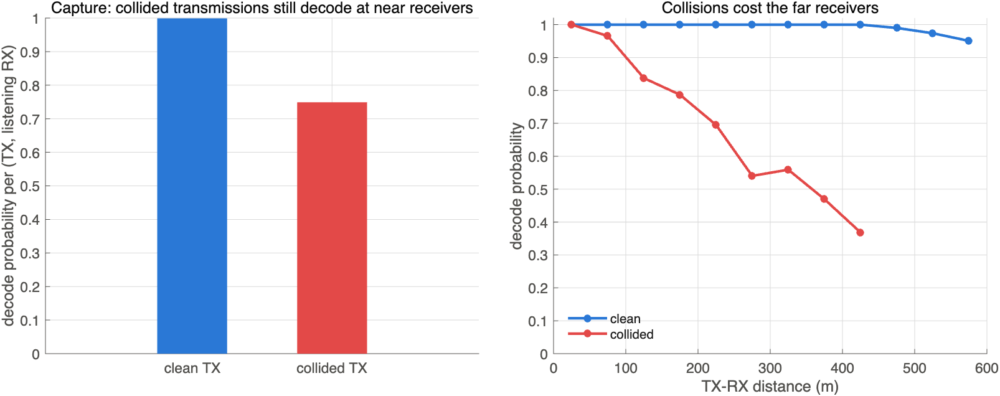

**Figure 9.4: What a collision costs.** A clean transmission is decoded by 99.9 % of listeners, a
collided one by 75 %: near receivers still capture the stronger signal, far ones lose it.

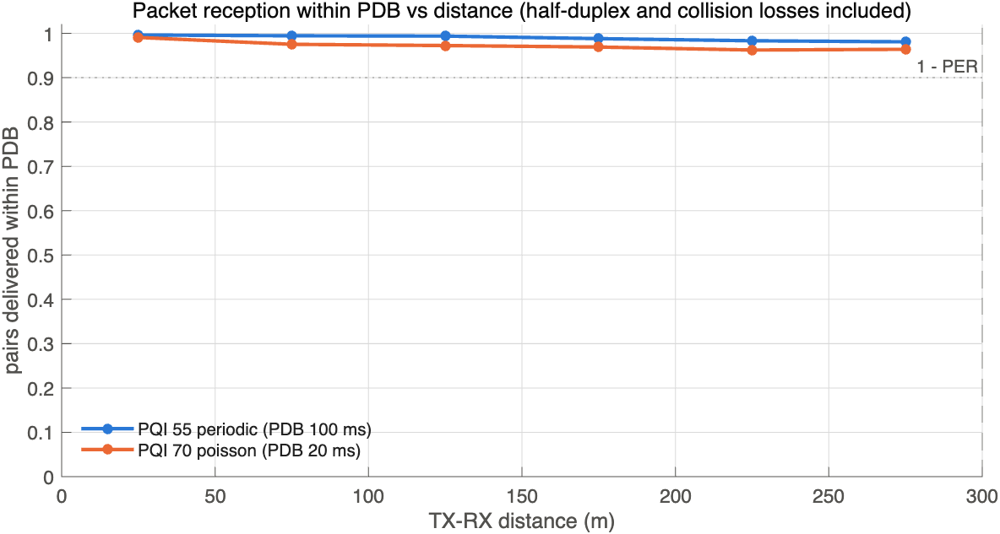
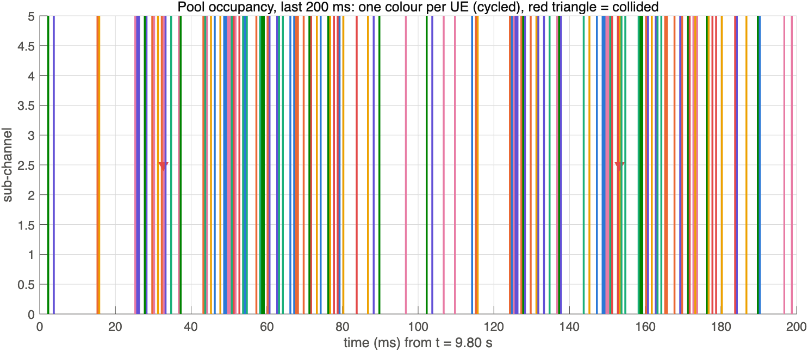

**Figures 9.5–9.6: On-time reception against distance, and 200 ms of pool occupancy** (red triangles
are collisions).

| Flow | Pairs | Within PDB (per link) | Per packet | Verdict |
|---|---|---|---|---|
| CAM | 66 132 | 98.8 % | 99.4 % | PASS |
| Event | 13 495 | 96.9 % | 97.4 % | PASS |

---

## 10. Which strategy serves event-driven data best

Eleven settings for the event flow, compared at the nominal density (31 vehicles) and at twice it
(67 vehicles). Ranking: event messages within 20 ms, among strategies that keep CAM above 90 %.

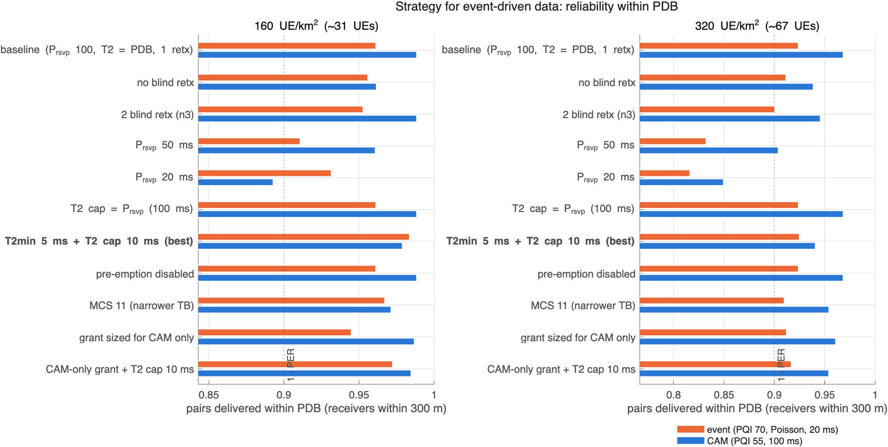

**Figure 10.1: Reliability within PDB per strategy.** Orange is the event flow, blue CAM; the dotted
line is the 90 % target; the bold label is the winner at that density.

| Strategy | Event, 31 veh. | CAM, 31 veh. | Event, 67 veh. | CAM, 67 veh. | CBR 31 / 67 |
|---|---|---|---|---|---|
| Baseline (P<sub>rsvp</sub> 100 ms, T2 = PDB, 1 retx) | 96.1 % | 98.9 % | 92.4 % | 96.9 % | 0.30 / 0.60 |
| No blind retransmission | 95.6 % | 96.2 % | 91.2 % | 93.9 % | 0.16 / 0.33 |
| 2 blind retransmissions | 95.3 % | 98.9 % | 90.1 % | 94.6 % | 0.41 / 0.71 |
| P<sub>rsvp</sub> 50 ms | 91.1 % | 96.1 % | 83.2 % ✗ | 90.4 % | 0.29 / 0.53 |
| P<sub>rsvp</sub> 20 ms | 93.2 % | 89.3 % ✗ | 81.7 % ✗ | 85.0 % ✗ | 0.26 / 0.50 |
| **Short window: T2min 5 ms, T2 ≤ 10 ms** | **98.4 % (best)** | 97.9 % | **92.5 % (best)** | 94.1 % | 0.30 / 0.57 |
| MCS 11 | 96.7 % | 97.1 % | 91.0 % | 95.4 % | 0.24 / 0.48 |
| Grant sized for CAM only | 94.5 % | 98.7 % | 91.2 % | 96.1 % | 0.22 / 0.45 |
| CAM-only grant + short window | 97.3 % | 98.5 % | 91.7 % | 95.4 % | 0.21 / 0.41 |

✗ = PDB violated. Two further strategies behaved exactly as the baseline and are left out of the
table: capping T2 at 100 ms (the CAM's PDB already is 100 ms) and disabling pre-emption (it never
fires when every vehicle has one priority).

**A short selection window for event messages is the best strategy, and its price grows with load.**
At nominal density it is clearly best: 98.4 % on time (baseline 96.1 %), and the 95th-percentile
event latency falls from 18 to 12 ms. At twice the density it still ties the baseline for events
(92.5 % against 92.4 %), but it crowds everyone into fewer candidates: collisions rise from 23 % to
30 % and CAM reliability falls from 96.9 % to 94.1 %. **The policy to deploy is adaptive:** use the
short window for events while CBR is below about 0.3, and let it relax toward the PDB as CBR passes
about 0.5, where it no longer improves events and only costs CAM. Sizing the grant for CAM only frees
the most channel (CBR 0.30 → 0.21 together with the short window) for a small event cost.

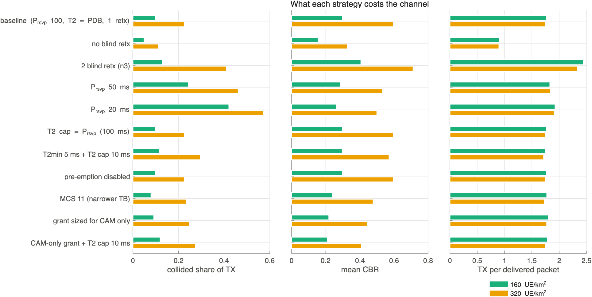
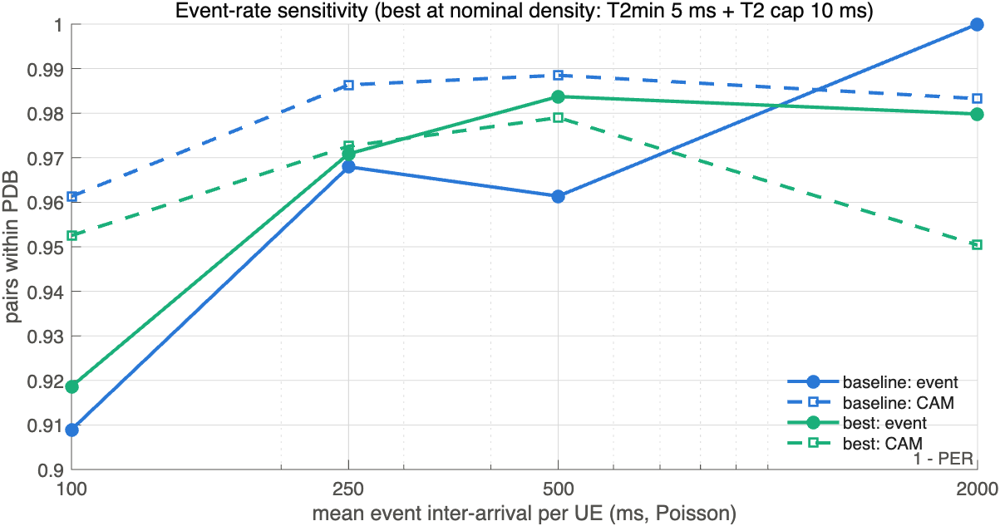

**Figures 10.2–10.3: What each strategy costs the channel, and sensitivity to the event rate.** At
one event per 100 ms per vehicle both the baseline (90.9 %) and the short window (91.9 %) sit at the
edge of the target; the short window's advantage holds at 250 and 500 ms mean spacing.

---

## 11. HARQ and RLC segmentation

### 11.1 HARQ on or off, through the whole MAC

One transmitter, one receiver, a 300 B CAM every 50 ms, every MAC procedure active.

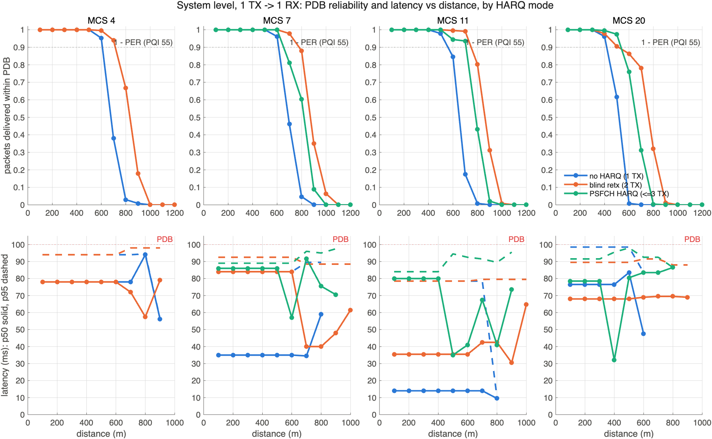

**Figure 11.1: On-time delivery and latency against distance for three HARQ modes.** Last distance
(100 m steps) with at least 90 % within PDB:

| MCS | No HARQ | Blind retransmission | PSFCH feedback |
|---|---|---|---|
| 4 | 600 m | 700 m | **infeasible** |
| 7 | 600 m | 700 m | 600 m |
| 11 | 500 m | 700 m | 700 m |
| 20 | 400 m | 500 m | 500 m |

**Blind retransmission matches or beats feedback everywhere.** Feedback shrinks every TB (Figure 4.2),
so a 300 B CAM needs 4 sub-channels instead of 3 (1.2 dB less SNR per RE), and at the edge of range
the feedback itself is lost. **MCS 4 with feedback cannot send a 300 B CAM at all:** its largest TB
on 50 PRB is 233 B.

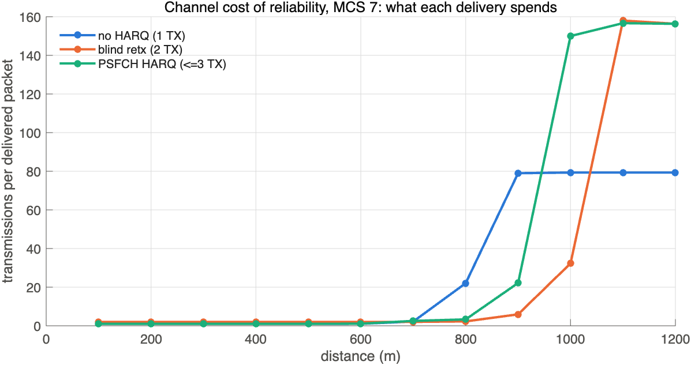

**Figure 11.2: What reliability costs.** Feedback spends 1.0 transmission per delivered packet on a
good link, blind retransmission always about 2; near the range limit every mode's cost explodes.

### 11.2 RLC segmentation

Full stack and waveform, two vehicles in convoy, one message every 100 ms, RLC unacknowledged mode.
The largest TB in the pool at MCS 7 is 560 B, so a larger message is cut into segments, each needing
its own resource selection inside the remaining PDB; if any segment is lost, the whole message is.

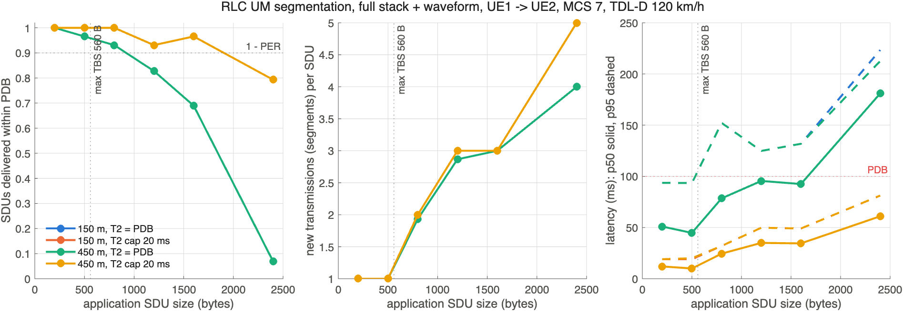

**Figure 11.3: Message size against reliability, segments and latency.** The 150 m and 450 m lines
coincide (both links are clean).

| Message | Segments | Within PDB, T2 = PDB | Median / p95 latency | Within PDB, T2 ≤ 20 ms | Median / p95 |
|---|---|---|---|---|---|
| 200 B | 1 | 100 % | 51 / 94 ms | 100 % | 12 / 19 ms |
| 500 B | 1 | 97 % | 45 / 93 ms | 100 % | 10 / 19 ms |
| 800 B | 2 | 93 % | 79 / 152 ms | 100 % | 25 / 32 ms |
| 1200 B | 3 | 83 % ✗ | 96 / 125 ms | 93 % | 35 / 50 ms |
| 1600 B | 3 | 69 % ✗ | 93 / 132 ms | 97 % | 35 / 49 ms |
| 2400 B | 4–5 | **7 % ✗** | 181 / 223 ms | 79 % ✗ | 61 / 81 ms |

Each segment draws its resource anywhere in the remaining window, so with T2 at the PDB the segments
of one message spread over the whole budget. Capping T2 at 20 ms keeps a segment chain short.
(29 messages per point: about ±10 points of sampling error.)

---

## 12. Waveform-level deployment with real hardware

Every result so far came either from the link-level simulator (one link, a real waveform) or from
the system-level simulator (many vehicles, an SINR formula and a BLER table). This section removes
the formula: many vehicles, every one a full protocol stack producing real IQ samples, all
transmissions **added together as waveforms** at every receiver, through models of real
transmitter and receiver hardware.

### 12.1 How it works

1. **Deployment.** Vehicles are a Poisson point process in 500 m × 500 m (this drop: 31), each
   driving at 30–70 km/h in a random direction and reflecting at the field edge.
2. **Transmitter hardware** (MATLAB Communications Toolbox), per vehicle: 12-bit DAC → IQ
   imbalance (0.1 dB, 0.5°) → oscillator phase noise (−95 dBc/Hz at 100 kHz) → carrier-frequency
   error (uniform ±0.1 ppm, the TS 38.101-1 limit) → Rapp power amplifier (saturation 30 dBm).
   The PA drive is calibrated so the antenna port averages **23 dBm after compression**. Measured
   on the model: transmit EVM 5.5 % (the 64QAM limit is 8 %), in-band emission −48 dBc.
3. **Channel**, per directed link: RMa path loss at the current distance, its own TDL-D fading
   channel run in continuous time with Doppler from both vehicles' speeds, and the **true
   propagation delay plus both vehicles' timing errors** (uniform ±0.25 µs).
4. **Summation in continuous time.** Each receiver keeps a running sample stream. Every arriving
   waveform is placed at its fractional delay and added. A late arrival's tail spills into the
   next slot, and an arrival later than the cyclic prefix allows causes inter-symbol interference.
5. **Receiver hardware**, per vehicle: thermal noise (NF 9 dB) → its own oscillator error and
   phase noise → IQ imbalance → AGC set on the AGC symbol (12 dB back-off) → 10-bit ADC.
6. **Decoding** by the full stack: blind PSCCH search, DM-RS channel estimation, LDPC, HARQ
   combining, MAC, RLC, PDCP, SDAP, up to the application.

Nothing about interference is computed by formula: collisions, partial overlaps, leakage and
timing effects are whatever the summed waveform does to the decoder.

### 12.2 Results: three runs on the same drop and traffic

| Run | CAM within 100 ms | Event within 20 ms | Late | Lost to collision | Lost to radio / hardware |
|---|---|---|---|---|---|
| Real hardware | **85.2 % ✗** | **62.2 % ✗** | 638 | 1 938 | 120 |
| Ideal hardware (impairments off) | 85.4 % ✗ | 62.9 % ✗ | 638 | 1 897 | 120 |
| Real hardware, no PDCP reordering hold | 86.6 % ✗ | **83.0 % ✗** | 3 | 1 938 | 120 |

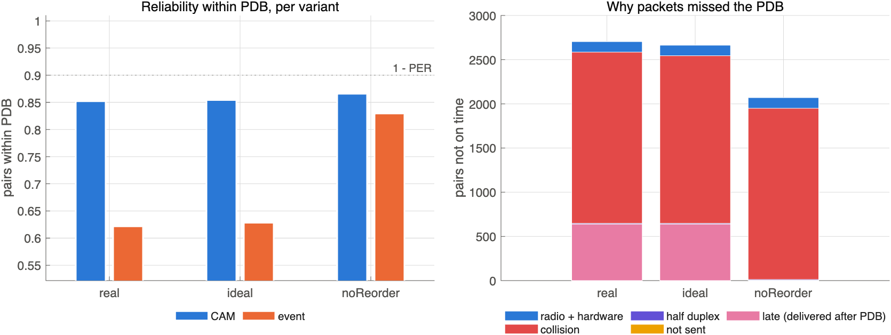

**Figure 12.1: Reliability per run, and why packets missed the budget.** *How to read it:* left,
the share of (packet, receiver) pairs delivered within the PDB; right, every miss by cause.

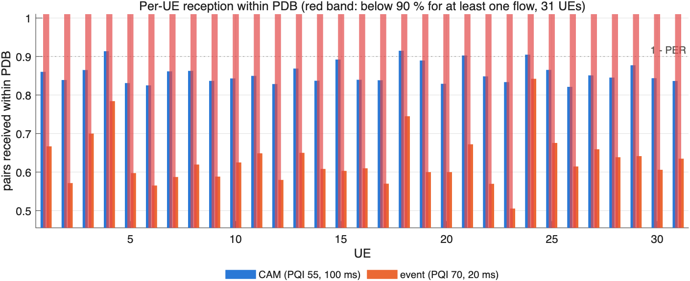

**Figure 12.2: Every vehicle, real hardware.** All 31 vehicles miss the 90 % target for at least one
flow; CAM reception ranges 82–91 % across vehicles, so the problem is pool-wide.

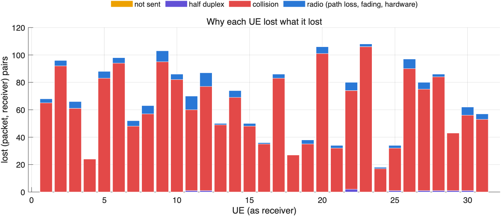
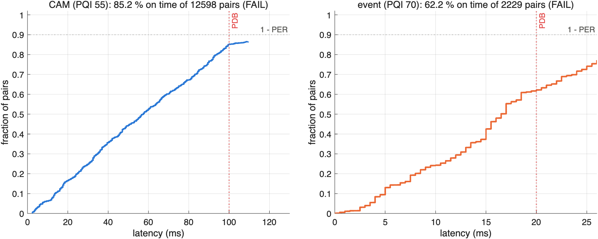

**Figures 12.3–12.4: Loss causes per vehicle, and the latency distributions.**

What the three runs show:

- **Collisions are almost the whole story.** 27.2 % of transmissions overlap another in slot and
  sub-channel (133 of them PSCCH on PSCCH). A collided transmission is decoded by 29 % of
  listeners, a clean one by 99.6 %. The cause is the full stack's MAC: it uses dynamic grants
  (no reservation period), so a resource is never announced before it is used and two vehicles
  selecting at the same moment cannot see each other. The system-level simulator reserves
  periodically and its sensing protects most transmissions, which is why it reported CAM ≈ 99 %
  in the same field. **The gap between the two simulators is mainly MAC behaviour, not physics.**
- **The PDCP reordering hold is the event flow's largest single loss.** A broadcast receiver opens
  each new source's receive window below the first sequence number it hears (TS 38.323 §7.1), so
  the first packet from every source waits t-Reordering = 10 ms. Events are rare, so many are
  first packets: 463 events arrived 1–9 ms after their 20 ms budget. Without the hold, event
  reliability rises from 62 % to 83 %.
- **Real hardware costs little at this operating point:** 0.2–0.7 points of reliability and about
  0.25 dB of effective SINR. Collision counts are identical in all three runs, so the MAC made
  the same decisions; only reception changed.
- **CBR measured from received energy** is 0.19 (0.186–0.203 across vehicles), close to the
  system level's figure for the same density. AGC clipping touched 0.02 % of samples.

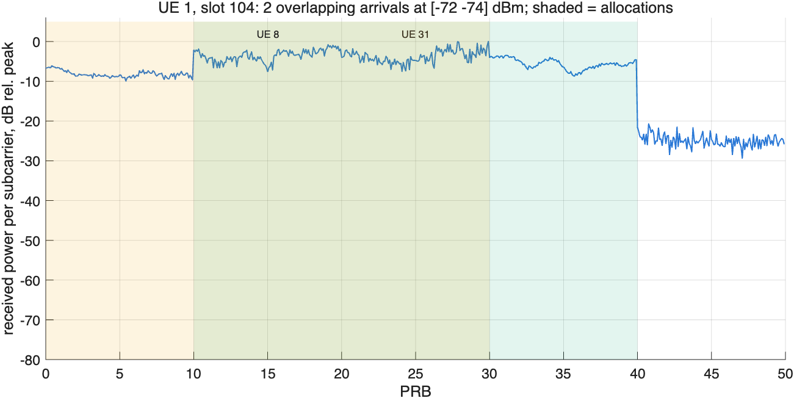

**Figure 12.5: One received slot with two overlapping transmissions** (−72 and −74 dBm, overlapping
on PRB 10–30). The empty PRBs 40–50 sit about 24 dB below the signals: that is thermal noise
(≈ 23 dB SNR per subcarrier at these powers). The PA's −48 dBc in-band emission is far below it.
Leakage becomes visible only near-far, when a very close transmitter sits next to a weak distant
signal.

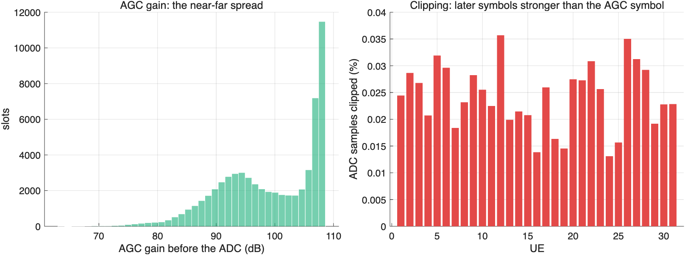
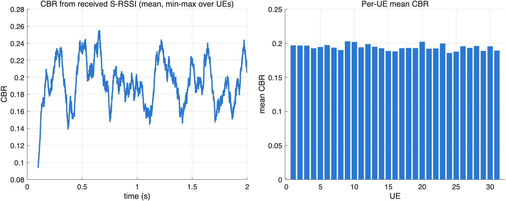

**Figures 12.6–12.7: AGC gain (the near-far spread) and clipping; CBR over time and per vehicle.**

### 12.3 How good is the system-level interference formula?

For every transmission and every vehicle listening in that slot, the system-level SINR was
recomputed exactly as the system simulator would (path loss, interferers weighted by sub-channel
overlap, noise over the victim's band) and turned into a predicted decode probability with the
measured BLER tables. That prediction is set against what the waveform decoder did.

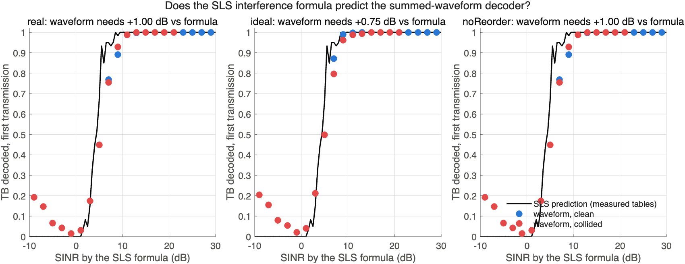

**Figure 12.8: Predicted (black) against observed decoding (dots: blue clean, red collided), per
system-level SINR.**

- **Around the waterfall the formula is about 1 dB optimistic** (0.75 dB with ideal hardware).
  The residual comes from the stored pool (14 symbols, PSFCH every slot, per-grant width) differing
  from the geometry the BLER table was measured on, plus the per-link fading realisations.
- **For partial collisions at low SINR the formula is pessimistic.** Collided transmissions with a
  formula SINR of −10 to −3 dB still decode 5–20 % of the time, where the formula says never. The
  formula spreads the interferer's power over the whole allocation; the real receiver estimates
  noise plus interference per sub-channel, so the hit sub-channel's symbols become near-erasures and
  LDPC recovers the block from the clean ones.

**Verdict:** the system-level PHY abstraction is good to about 1 dB for clean links and conservative
for partial overlaps. The large differences between the system-level and waveform-level results
come from the MAC (periodic reservations against dynamic grants) and from the PDCP reordering
hold, neither of which is a PHY effect.

### 12.4 Limits of this run

- One drop, 2 s of air time, one seed. Per-vehicle numbers carry a few points of sampling error.
- The full stack has no periodic reservations, re-evaluation, pre-emption or congestion control,
  so this run shows dynamic-grant Mode 2, not the semi-persistent variant the system level models.
- The hardware parameters are typical-module assumptions (`+rf/hwDefaults.m`); measured values from
  your field hardware should replace them.

---

## 13. Every violated packet delay budget

`experiments.pdbViolations` scans every saved result and lists each configuration where a flow
delivers less than 90 % of its packets within its PDB. The full table, 103 rows with shortfall and
measured context, is [`data/pdbViolations.csv`](../data/pdbViolations.csv). In the figures every
violating point is ringed in red.

### 13.1 Load and channel access (system level, 20 MHz, RMa)

| Where | Condition | Flow | Within PDB | Shortfall | Cause (measured) |
|---|---|---|---|---|---|
| CBR (§8) | 80 vehicles, CAM every 20 ms | CAM, 100 ms | **41.0 %** | 49.0 pt | CBR 0.96, 99 % of TX collide |
| CBR (§8) | 40 vehicles, every 20 ms | CAM, 100 ms | **75.2 %** | 14.8 pt | CBR 0.80, 85 % collide |
| Latency (§7) | 120 vehicles | Event, 20 ms | **80.0 %** | 10.0 pt | CBR 0.81, 58 % collide |
| Strategy (§10) | P<sub>rsvp</sub> 20 ms, 67 vehicles | Event, 20 ms | **81.7 %** | 8.3 pt | 57 % collide, CBR 0.50 |
| Strategy (§10) | P<sub>rsvp</sub> 50 ms, 67 vehicles | Event, 20 ms | **83.2 %** | 6.8 pt | 46 % collide, CBR 0.53 |
| CBR (§8) | 80 vehicles, every 50 ms | CAM, 100 ms | **84.5 %** | 5.5 pt | CBR 0.65, 74 % collide |
| Strategy (§10) | P<sub>rsvp</sub> 20 ms, 67 vehicles | CAM, 100 ms | **85.0 %** | 5.0 pt | 57 % collide |
| Latency (§7) | 120 vehicles | CAM, 100 ms | **86.7 %** | 3.3 pt | CBR 0.81, 58 % collide |
| Latency (§7) | P<sub>rsvp</sub> 20 ms, 40 vehicles | Event, 20 ms | **89.2 %** | 0.8 pt | 47 % collide, CBR 0.32 |
| Strategy (§10) | P<sub>rsvp</sub> 20 ms, 31 vehicles | CAM, 100 ms | **89.3 %** | 0.7 pt | 42 % collide, CBR 0.26 |

**Two causes account for every row:** a channel past CBR ≈ 0.6 (collisions above about 50 %), or a
reservation period shorter than the traffic period (sensing blind to the reservation, §7.2), which
breaks the budget even on a half-empty channel.

**Passing with little margin:** at 80 vehicles (§7) the event flow passes by 1.3 points, and with
two blind retransmissions at 67 vehicles (§10) by 0.1.

### 13.2 Waveform level (§12, 31 vehicles, dynamic-grant MAC)

| Run | Flow | Within PDB | Shortfall | Cause (measured) |
|---|---|---|---|---|
| Real hardware | Event, 20 ms | **62.2 %** | 27.8 pt | 466 late (PDCP reordering hold), 351 lost to collision |
| Ideal hardware | Event, 20 ms | **62.9 %** | 27.1 pt | the same: hardware is not the cause |
| No reordering hold | Event, 20 ms | **83.0 %** | 7.0 pt | 351 lost to collision |
| Real hardware | CAM, 100 ms | **85.2 %** | 4.8 pt | 1 587 lost to collision, 172 late |
| Ideal hardware | CAM, 100 ms | **85.4 %** | 4.6 pt | 1 563 lost to collision |
| No reordering hold | CAM, 100 ms | **86.6 %** | 3.4 pt | 1 587 lost to collision |

At waveform level every run violates both budgets: the dynamic-grant MAC collides 27 % of
transmissions, and the reordering hold makes rare event messages late.

### 13.3 Message size (full stack, RLC segmentation, §11.2)

| Message | Selection window | Within PDB | Shortfall | Cause |
|---|---|---|---|---|
| 2400 B | T2 = PDB | **6.9 %** | 83.1 pt | 4 segments, each a separate selection spread over the budget |
| 1600 B | T2 = PDB | **69.0 %** | 21.0 pt | 3 segments |
| 2400 B | T2 ≤ 20 ms | **79.3 %** | 10.7 pt | 5 segments |
| 1200 B | T2 = PDB | **82.8 %** | 7.2 pt | 3 segments |

Identical at 150 m and 450 m: segmentation, not the radio, breaks these.

### 13.4 Range (system level, one link, §11.1)

The budget is violated from the first distance listed onward, for every larger distance tested
(100 m steps up to 1200 m):

| MCS | No HARQ | Blind retransmission | PSFCH feedback |
|---|---|---|---|
| 4 | from 700 m (38 % on time there) | from 800 m (67 %) | **always: a 300 B CAM does not fit any TB** |
| 7 | from 700 m (46 %) | from 800 m (88 %) | from 700 m (81 %) |
| 11 | from 600 m (85 %) | from 800 m (80 %) | from 800 m (43 %) |
| 20 | from 500 m (62 %) | from 600 m (86 %) | from 600 m (76 %) |

All of these are the RMa link budget running out (§5); under free-space propagation each would move
out by roughly a factor of two.

---

## 14. What moves what: factor summary

How each parameter moves the four quantities this study cares about. Arrows give the direction of
the effect when the parameter **increases**; numbers are from the sections cited.

| Parameter (↑) | Latency | Reliability within PDB | Throughput / capacity | Range | Evidence |
|---|---|---|---|---|---|
| **Vehicle density / offered load** | ≈ unchanged | ↓↓ (99.0 → 86.7 % CAM, 95.9 → 80.0 % event, 40 → 120 veh.) | ↓↓ remaining capacity (staircase) | — | §7.2, §8 |
| **CBR** | ≈ unchanged | ↓ slowly to 0.6, then ↓↓ | ↓ in steps: 10 → 6 → 3 → 1.2 → 0.5 Mbit/s | — | §8 |
| **MCS** | ≈ | ↓ at range; ≈ inside range | ↑ link rate (7.2 → 14.3 Mbit/s, MCS 5 → 11) | ↓ (575 → 440 m, MCS 5 → 11) | §5, §6 |
| **Doppler speed** | — | ↓ for 64QAM | ↓↓ for high MCS (MCS 27: 50.9 → 0 Mbit/s, 30 → 120 km/h) | ↓ | §6.2 |
| **DM-RS symbols (2 → 4)** | — | ↑ for high MCS | ↑↑ MCS 27 (0 → 43.8 Mbit/s); ↓ peak of others slightly | ↑ | §6.2 |
| **Selection window T2 (shorter)** | ↓↓ (51 → 25 ms CAM median; 18 → 12 ms event p95) | ↑ events; ↓ CAM at high load | ≈ | — | §7, §10 |
| **Reservation period P<sub>rsvp</sub> (shorter than traffic)** | ↓ (52 → 12 ms CAM median) | ↓↓ (sensing blind): violates PDB | ↓ (collisions 12.5 → 47 %) | — | §7.2, §10 |
| **Blind retransmissions (0 → 1 → 2)** | ≈ | ↑ then ↓ (93.4 → 95.9 → 95.4 % event) | ↓ (CBR 0.20 → 0.38 → 0.50) | ↑ (+100–150 m) | §7.2, §11.1 |
| **PSFCH feedback (vs blind)** | ↑ slightly | ≈ inside range, ↓ at the edge | ↓ TBS −28 to −38 % in every slot | ≈ or ↓ (no gain over blind) | §4, §11.1 |
| **Allocation width (fewer PRB)** | — | ↑ at range | ↓ link rate | ↑ (+7 dB, 50 → 10 PRB) | §5 |
| **Message size past one TB** | ↑↑ (51 → 181 ms median, 200 → 2400 B) | ↓↓ (100 → 6.9 %) | — | — | §11.2 |
| **Grant sized for periodic traffic only** | ≈ | ↓ slightly for events | ↑ (CBR 0.30 → 0.22) | — | §10 |
| **Path-loss model (RMa → free space)** | — | — | — | ↑↑ (MCS 5: 575 → 1310 m) | §5.4 |
| **Real hardware impairments (vs ideal)** | ≈ | ↓ 0.2–0.7 pt | ≈ (−0.25 dB effective SINR) | ≈ | §12 |
| **PDCP t-Reordering at broadcast receivers (10 ms → 0)** | ↓ (event p95 28 → 19 ms) | ↑↑ events (62 → 83 %) | — | — | §12 |
| **MAC: dynamic grants (full stack) vs periodic reservations (SLS)** | ≈ | ↓↓ (CAM 99 → 85 %) | ↓ (27 % of TX collide vs 7–12 %) | — | §9, §12 |

---

## 15. Validity, limitations and defects found

### 15.1 Assumptions that bound the results

- **Path loss is TR 38.901 RMa** at 1.5 m antennas: about 15 dB more loss than free space at 1.4 km
  (§5.4). Ranges are conservative; on an open road the same radio reaches about twice as far, and
  the system-level effects of that (more neighbours heard, higher CBR) are not in these numbers.
- **No shadowing**, and fading is not reciprocal (each direction draws its own channel).
- **The system-level PHY is a table**: every link at the same SINR gets the same average BLER. The
  waveform-level deployment (§12) checks this abstraction: about 1 dB optimistic near the decode
  threshold, pessimistic for partial collisions.
- **Synchronisation is ideal** in system-level runs; the S-SSB chain is verified separately at
  link level.
- **Decoding takes no time** in the system level: a TB counts as received in the slot it is sent; the
  receiver's processing is the 2-slot margin reserved at the end of the PDB.
- **One drop per density** in the field and strategy runs (3 traffic seeds); a different drop moves
  individual numbers by a few points.

### 15.2 Defects found and fixed while building this study

All seven passed every existing test; each was found because an experiment produced a number that
could not be explained.

1. **Event packets expired without ever being sent.** The "cannot meet the remaining PDB" reselection
   (TS 38.321 §5.22.1.2) stopped firing after a grant's first reservation period, so a 20 ms event
   waited for a 100 ms grant. Fixed: 8 of 24 → 26 of 26 delivered on time in a 15-vehicle test.
2. **The number of blind retransmissions could not be changed:** every grant reserved 2 resources
   whatever the setting. Fixed: the grant now reserves `numRetx + 1`, up to `sl-MaxNumPerReserve`.
3. **No selection-window cap in the system level** (the full stack had one). Added
   `policy.t2MaxMs`, the same rule.
4. **Persistent grants over-reserved for random traffic:** a grant reserved room for one event in
   every period although events came once in five, making every grant the whole channel. Added
   `policy.sizeEventFlows` (default unchanged) and compared it as a strategy (§10).
5. **The system-level suite first ran on a 40 MHz pool** (the simulator's own default). Every
   experiment is now pinned to and checked against the 20 MHz operating point.
6. **Interference was scaled by the wrong width.** Each interferer was weighted by the overlap over
   the *victim's* allocation width; an interferer spreads its power over its *own* width. A narrow
   interferer on a wide victim was understated by up to 10·log10(L). Found while explaining how
   interference is modelled; the test now checks the SINR against S / (N + P) directly.
7. **Sensing recorded total received power as RSRP.** TS 38.215 defines SL-RSRP per DM-RS resource
   element; the total over 50 PRB is 27.8 dB higher. Every decoded neighbour looked like an occupant,
   and the 120-vehicle field needed 10 threshold escalations (+30 dB) to undo it; now 1. Fixing 6
   and 7 changed most system-level numbers by a point or less, and slightly raised collision rates
   (sensing now excludes only neighbours genuinely above the threshold).

### 15.3 Found, not fixed (needs a normative change)

- **PSSCH mapping skips symbols 1–2 outside the control channel.** TS 38.214 §8.1.2.1 starts the data
  channel at `sl-StartSymbol + 1`, and the TBS formula (§8.1.3.2) counts those resource elements,
  but the mapping function starts at the first DM-RS symbol (visible in Figure 4.2's zoom). Its effect
  grows with allocation width. Fixing it requires the project's normative verification cycle and a
  new BLER table.
- **The shipped BLER table has only MCS 4, 7, 11, 16 and 20**, and the system level silently reads
  the nearest row for any other MCS. This study measured its own curves for every MCS and refuses
  system-level runs at unmeasured MCS.

---

## 16. Conclusions and recommendations

### 16.1 Conclusions

1. **Latency in Mode 2 is a scheduling quantity.** With the selection window running to the PDB, a
   message waits on average half its budget (≈ 51 ms for a 100 ms CAM, ≈ 10 ms for a 20 ms event),
   independent of load and distance. Every configuration measured kept latency inside the PDB for
   the packets that arrived; what fails under stress is *whether* they arrive.
2. **Reliability is set by channel load.** Up to CBR ≈ 0.6 both message types meet their 90 %
   target in a 20 MHz channel; beyond it collisions exceed 50 % and the budget is violated. With the
   default settings this happens at about 100–120 vehicles in 0.25 km², or far earlier when
   vehicles send more often.
3. **Throughput on a 20 MHz channel** ranges from 7.2 Mbit/s (MCS 5) to 14.3 Mbit/s (MCS 11) per
   link, and about 22–25 Mbit/s with ideal link adaptation at short range. MCS 27's 52 Mbit/s is out
   of reach at highway speed with two DM-RS symbols; four DM-RS symbols recover 44 Mbit/s.
4. **Range is set by the MCS and, above all, the propagation model.** Sensitivity runs from
   −92.4 dBm (MCS 0) through −87.2 dBm (MCS 5) to −82.6 dBm (MCS 11) over 50 PRB. Under RMa this
   gives 775 / 575 / 440 m; the field measurement of 1400 m for MCS 5 agrees with the same receiver
   under free-space loss (1310 m), so the RMa ranges are conservative by about a factor of two.
5. **Remaining capacity falls as the configured staircase**: the whole 10 Mbit/s pool below
   CBR 0.2, 6 / 3 / 1.2 / 0.5 Mbit/s in the levels above. The CR limit never bound in these runs,
   so it did not prevent the collisions above CBR 0.6.
6. **Summed waveforms through real hardware confirm the PHY abstraction to about 1 dB.** Real
   transmitter and receiver impairments (PA compression, phase noise, ±0.1 ppm, timing error, AGC,
   10-bit ADC) cost about 0.25 dB and under one point of reliability at 23 dBm in a 500 m field. What
   the waveform-level run exposes is higher in the stack: a dynamic-grant MAC that cannot announce
   its resources (27 % of transmissions collide; CAM 85 %), and a PDCP reordering hold that makes
   rare event messages late (events 62 %, 83 % without the hold).

### 16.2 Recommendations

1. **Match the reservation period to the traffic period.** A shorter P<sub>rsvp</sub> hides the
   vehicle from its neighbours' sensing and is the most common cause of violated budgets here.
2. **Make the selection window adaptive.** Cap T2 near 10 ms for event traffic while CBR is below
   about 0.3; relax it toward the PDB as CBR passes 0.5, where it stops helping events and costs CAM.
3. **Use one blind retransmission, not two.** The second costs more channel than it returns.
4. **Prefer blind retransmission to PSFCH feedback for broadcast-like safety traffic**: feedback
   shrinks every transport block in the pool and gains no range.
5. **Keep safety messages inside one transport block** (≤ 560 B at MCS 7 on 50 PRB); a segmented
   message must be sent with a short selection window or it misses its budget.
6. **Use MCS 5–7 for range, MCS 11 for capacity**, and add DM-RS symbols before using 64QAM at
   highway speed.
7. **Add a CBR-driven congestion response** (fewer retransmissions or a higher MCS above CBR ≈ 0.5):
   the CR limit alone does not engage at these loads.
8. **Calibrate the path-loss model against the field** before using any absolute range from this
   study; free space reproduces the MCS 5 measurement, RMa at 1.5 m antennas does not.
9. **Use periodic reservations for periodic traffic.** The waveform-level run, with dynamic grants
   only, collides 27 % of transmissions where the reserving system level collides 7–12 % at the same
   density.
10. **Deliver broadcast event messages out of order** (t-Reordering = 0 at broadcast receivers, which
    TS 38.331 leaves to the UE): the 10 ms hold alone moves event reliability from 83 % to 62 %.

---

## 17. Reproducing every number

All experiments live in the MATLAB package `+experiments/` and write figures to
`plots/experiments/`, data to `plots/experiments/data/`. This folder holds a copy of both.

```matlab
experiments.runAll()                                   % everything, about 2-3 h on 6 workers
s = experiments.settings(); s.scale = 'quick';
experiments.runAll(s)                                  % smoke test, minutes
experiments.rxSensitivity()                            % one experiment
experiments.pdbViolations()                            % the violations table (CSV)
experiments.waveDeploy()                               % waveform deployment, 3 runs, ~40 min
[r, S] = runDeploy();                                  % one deployment; edit deployConfig.m
```

| Experiment | Section | Engine |
|---|---|---|
| `slotStructure` | 4 | normative chains |
| `linkCurves`, `rxSensitivity` | 5 | link level |
| `throughputMcs`, `distance` | 6, 11.1 | link level + system level |
| `latency` | 7 | system level |
| `cbrCapacity` | 8 | system level |
| `field` | 9 | system level |
| `eventStrategy` | 10 | system level |
| `rlcSegmentation` | 11.2 | full stack |
| `waveDeploy` (`runDeploy`, `deployConfig.m`) | 12 | waveform level, continuous time, Communications Toolbox hardware |
| `sensingSelection` | Appendix B | system level |

The operating point is in `+experiments/settings.m` (`s.op`), the field scenario in
`+experiments/fieldConfig.m`.

---

## Appendix A: Glossary

| Term | Meaning |
|---|---|
| **Mode 2** | sidelink resource allocation where each vehicle selects its own resources, without a base station |
| **PDB** | packet delay budget: the latest a packet may arrive |
| **PER** | packet error rate allowed; a late packet counts as an error |
| **PQI** | PC5 QoS identifier: a row of TS 23.287 Table 5.4.4-1 fixing PDB, PER and priority |
| **MCS** | modulation and coding scheme: modulation order (QPSK, 16QAM, 64QAM) and code rate |
| **TBS / TB** | transport block (size): the bits one transmission carries |
| **PRB** | physical resource block: 12 subcarriers × one slot |
| **Sub-channel** | the frequency unit of selection, here 10 PRB |
| **BLER** | block error rate: share of TBs that fail LDPC decoding or the CRC check |
| **Sensitivity** | received power at which BLER ≤ 10 % |
| **SCI-1A** | first-stage sidelink control information; announces a vehicle's reserved resources |
| **S<sub>A</sub>** | candidate set: resources left after excluding neighbours' reservations |
| **T1, T2** | start and end of the selection window, in slots after the trigger |
| **P<sub>rsvp</sub>** | reservation period: how often a grant repeats |
| **CBR** | channel busy ratio: share of sub-channels whose received energy exceeded a threshold in the last 100 ms |
| **CR** | channel occupancy ratio: share of the pool this vehicle itself used |
| **sl-CR-Limit** | maximum CR allowed at each CBR level |
| **PSFCH** | sidelink feedback channel carrying HARQ acknowledgements |
| **HARQ** | hybrid automatic repeat request: retransmission with soft combining at the receiver |
| **Half-duplex** | a vehicle cannot receive in a slot it transmits in |
| **RMa** | Rural Macro path-loss model of TR 38.901 |
| **TDL-D** | tapped-delay-line fading channel with a strong line-of-sight path |

## Appendix B: Sensing and selection, in detail

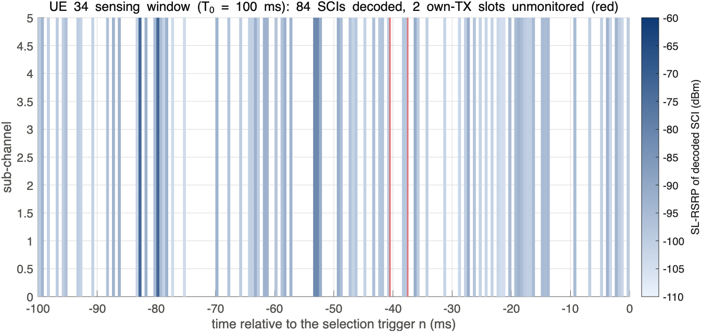

**Figure B.1: What one vehicle hears** (84 control messages). Control messages decoded in the last 100 ms (the sensing
window), coloured by received power; red lines mark slots the vehicle was transmitting in and so
could not listen.

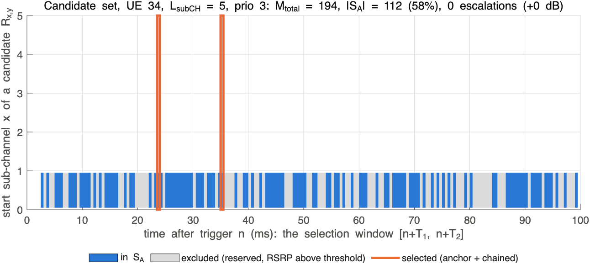

**Figure B.2: What it may choose.** Every cell is a candidate resource in the selection window: blue
survived exclusion, grey was excluded because a neighbour reserved it and was heard above the
threshold; orange outlines are the resources selected. Here every grant needs all 5 sub-channels
(the whole 20 MHz), so there is one candidate per slot: 194 candidates, 112 (58 %) usable.

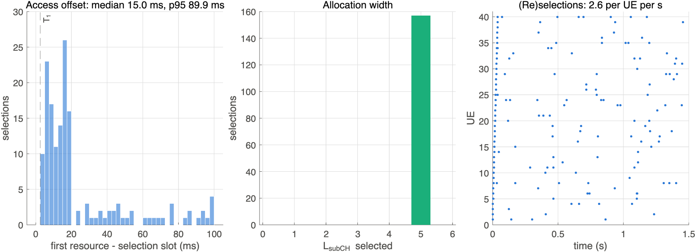

**Figure B.3: Selections over the run.** The wait from trigger to the first selected resource has a
median of 15 ms and a 95th percentile of 90 ms: the window spans the whole PDB.

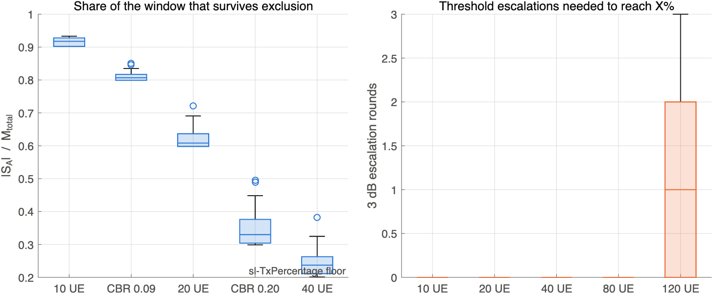

**Figure B.4: How much of the window survives, against load.**

| Vehicles | CBR | Candidates surviving (median) | Threshold raises needed (median) |
|---|---|---|---|
| 10 | 0.09 | 92 % | 0 |
| 20 | 0.20 | 81 % | 0 |
| 40 | 0.39 | 61 % | 0 |
| 80 | 0.69 | 33 % | 0 |
| 120 | 0.83 | 24 % | 1 (+3 dB) |

At 120 vehicles the threshold rises once (3 dB) before 20 % of candidates survive. (Before the RSRP
defect was fixed, §15.2 item 7, this read 10 escalations: an artefact of comparing total power with
a per-resource-element threshold.)
